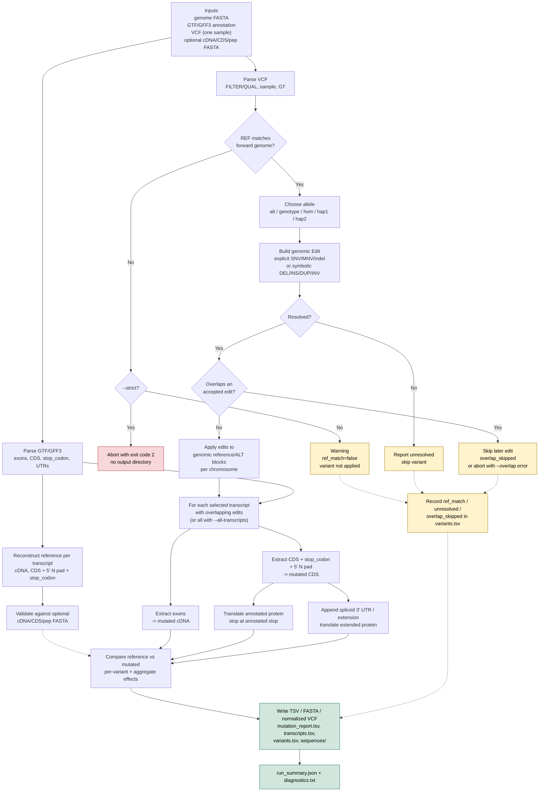

# mutatedSequence

**English** | [简体中文](README.zh-CN.md)

**Allele-aware mutated transcript, CDS and protein sequences from a VCF plus an Ensembl annotation.**

This repository started as a 2023 bcftools/`seqkit` pipeline. It has been
rewritten around a genome-first block model so that SNPs, MNVs, indels,
variants spanning exon junctions, negative-strand genes, multiallelic loci,
phased genotypes and common symbolic SVs can all be applied consistently.

The Python pipeline has **no third-party runtime dependencies** (Python ≥ 3.8).
The old shell scripts are kept only as deprecated references.

---

## Scope: what this tool is — and is not

This is a **sequence builder**, not a variant annotator or clinical classifier.
Given one sample's VCF, a matching genome FASTA and an Ensembl-style GTF/GFF3,
it produces full-length reference and mutated sequences per transcript.

**Good fit when you need:**

- full cDNA/CDS/protein, not only `c.`/`p.` annotations;
- one auditable row per variant with the original REF/ALT and before/after sequences;
- negative-strand genes, exon-spanning deletions, partial models and split stops;
- explicit control over ALT/genotype/overlap and common symbolic SVs;
- a small, dependency-free Python/Docker tool.

**Not a replacement for VEP/SnpEff when you need:**

- population, clinical, regulatory or protein-domain annotation;
- SIFT/PolyPhen/CADD/LOFTEE/SpliceAI-style predictors;
- true phased compound haplotypes (Haplosaurus/VCF2Prot are stronger);
- genome assembly or TRA/BND/CNV reconstruction;
- HLA/neoantigen prediction (pVACseq) or RNA-read evidence (Isovar).

### At a glance

| Capability | Status |
|---|---|
| Full cDNA, CDS, annotated protein, 3'-extended protein | ✅ |
| SNV, MNV, indel, complex replacement | ✅ |
| Negative-strand genes | ✅ tested |
| Variants spanning exon junctions / introns, whole-exon deletion | ✅ via the genome-first block model |
| 5' partial N pad, split stop codon, stop-loss readthrough | ✅ tested |
| Multiallelic / phased genotypes | ⚠️ one ALT per consensus; `hap1`/`hap2` use GT order; no phasing inference |
| True phased compound haplotypes | ❌ phase the VCF first; Haplosaurus/VCF2Prot are stronger |
| Splice-site / exon-skipping modeling | ❌ splice variants are annotated, exons are fixed |
| Symbolic `<DEL>`, `<INS>`, `<DUP>`, `<INV>` | ⚠️ supported with documented caveats; TRA/BND/CNV are not |
| Clinical/population/regulatory/HGVS annotation | ❌ use VEP/SnpEff/Mutalyzer |
| Docker image with environment only | ✅ source is bind-mounted |
| Proteome/cohort scale and performance benchmark | ⚠️ Python single-process; not benchmarked against Rust/C tools |
| Genetic code | ⚠️ standard nuclear code only |

## Workflow



Dashed arrows are warning/skip/reporting paths. The diagram assumes the
annotation and transcript structure are fixed; true phasing, splicing,
TRA/BND/CNV and other unsupported cases are outside the model (see
[Explicit limits](#explicit-limits-situations-this-tool-cannot-handle)).

---

## What the tool does


For each selected transcript it produces:

- **Reference and mutated cDNA** (all exons, 5'→3');
- **Reference and mutated CDS** (GTF CDS + `stop_codon` + 5' N pad);
- **Annotated protein** (translation stops at the annotated stop);
- **3'-extended protein** (spliced 3' UTR extension, for stop-loss/readthrough);
- **Genomic region** around the transcript, with all variants applied;
- **Per-variant and per-transcript effect tables**;
- A **normalized VCF** with explicit REF/ALT for SNVs, indels and common SVs;
- Diagnostics explaining REF offsets and non-stop transcripts.

Core properties:

- Genome-first application: variants are applied to genomic blocks, then exons
  and CDS segments are extracted. This handles variants spanning exon junctions.
- Negative-strand genes are handled correctly: the ALT allele is applied on the
  forward strand and the extracted exon/CDS is reverse-complemented as a whole.
- 5' partial models: the 1–2 N pad is preserved; the reading frame is not lost.
- Stop codons excluded from GTF CDS are added back from the `stop_codon`
  feature (or inferred from the genome / Ensembl CDS FASTA).
- Split stop codons across exon junctions are handled.
- Multiallelic, phased, unphased and overlapping genotypes are handled
  explicitly and reported.
- Symbolic `<DEL>`, `<INS>`, `<DUP>`, `<INV>` are converted to explicit edits
  when possible; unsupported alleles are reported instead of silently ignored.

---

## Explainer video

A 112-second, 1080p/30 fps Remotion explainer lives in [`animation/`](animation/).
It uses the playful-but-gentle Chinese voice `zh-CN-XiaoyiNeural` (-4% rate,
+2 Hz pitch) and cuts the 10 scenes to the actual narration durations.

- Direction and shot list: [`animation/STORYBOARD.md`](animation/STORYBOARD.md)
- Source and render instructions: [`animation/README.md`](animation/README.md)
- Render: `cd animation && ./render.sh` → `animation/out/explainer.mp4`
- The cut covers the hook, old per-exon pain points, inputs, REF check/`--strict`,
  allele selection, genomic blocks, cDNA/CDS/protein, auditable TSV, honest
  limits and the outro.

## Install

```bash
# Python >= 3.8; no third-party runtime dependencies
python -m pip install -e .

# or run directly from the repository
python -m mutatedseq --help
./mutatedSequence --help          # thin shell launcher
```

Optional external tools:

| Tool | Why |
|---|---|
| `samtools` | build/use `.fai` for low-memory random access |
| `bcftools` | cross-check the normalized VCF |
| `tabix` / `bgzip` | index larger VCFs/FASTAs |
| `seqkit` | only used by the deprecated legacy scripts |

### Reference data

Download the **same Ensembl release and assembly** for genome, GTF, cDNA, CDS
and peptide FASTA:

```bash
./downLoad.sh 109
# or use the Asia mirror:
ENSEMBL_FTP=https://ftp.asia.ensembl.org/pub ./downLoad.sh 109
```

For a human genome, the gzipped FASTA works, but the reader loads it into
memory. For low-memory random access, decompress and index once:

```bash
gunzip -c resource/Homo_sapiens.GRCh38.dna.toplevel.fa.gz \
  > resource/Homo_sapiens.GRCh38.dna.toplevel.fa
samtools faidx resource/Homo_sapiens.GRCh38.dna.toplevel.fa
```

The tool builds a `.fai` automatically for an uncompressed FASTA if one is
missing. `.gz` FASTA is accepted for small test data; a warning is printed for
a whole human genome.

---

## Docker

The Docker image is **environment-only**. It contains Python 3.12,
`samtools`, `bcftools`, `tabix`/`bgzip`, `wget`/`curl` and basic shell tools,
but **no repository code**. The repository is bind-mounted at `/workspace` at
runtime; this keeps the image reusable and guarantees that you run the code on
your disk.

The image was built and tested locally (Docker Desktop, Linux containers). A
portable archive is available at
`dist/mutatedsequence-2.0.0.tar.gz` after `docker save` (see below; `dist/` is
git-ignored, so build it yourself if it is absent).

### Prebuilt image (Docker Hub)

The image is published at
[`wenyuhaobuemoji/mutatedsequence`](https://hub.docker.com/r/wenyuhaobuemoji/mutatedsequence):

```bash
docker pull wenyuhaobuemoji/mutatedsequence:2.0.0
docker run -it --rm \
  -v "${PWD}:/workspace" \
  -w /workspace \
  wenyuhaobuemoji/mutatedsequence:2.0.0
```

Tags: `2.0.0` and `latest`. The image is still **environment-only**; the
repository is mounted from the host at `/workspace`. The build instructions
below are only needed if you want to build it yourself. In later examples,
replace `mutatedsequence:2.0.0` with
`wenyuhaobuemoji/mutatedsequence:2.0.0` when using the published image.

### Build

```bash
docker build -t mutatedsequence:2.0.0 -t mutatedsequence:latest .
```

`.dockerignore` restricts the build context to the `Dockerfile`, so the source
cannot accidentally be baked into the image.

### Interactive: `docker run -it --rm`

Linux / macOS / PowerShell:

```bash
docker run -it --rm \
  -v "${PWD}:/workspace" \
  -w /workspace \
  mutatedsequence:2.0.0
```

Windows `cmd.exe`:

```bat
docker run -it --rm -v "%cd%:/workspace" -w /workspace mutatedsequence:2.0.0
```

Git Bash (MSYS converts `/workspace` to a Windows path unless disabled):

```bash
MSYS_NO_PATHCONV=1 docker run -it --rm \
  -v "$(pwd -W):/workspace" \
  -w /workspace \
  mutatedsequence:2.0.0
```

Inside the container:

```bash
python -m mutatedseq --version
python -m mutatedseq --help
python -m mutatedseq run \
  -g tests/data/test.fa \
  -a tests/data/test.gtf \
  -v tests/data/test.vcf \
  -o tests/docker_out \
  --cds tests/data/test.cds.fa \
  --cdna tests/data/test.cdna.fa \
  --pep tests/data/test.pep.fa \
  --sample S1
exit
```

### One-shot command

```bash
docker run --rm \
  -v "${PWD}:/workspace" \
  -w /workspace \
  mutatedsequence:2.0.0 \
  python -m mutatedseq run \
    -g tests/data/test.fa \
    -a tests/data/test.gtf \
    -v tests/data/test.vcf \
    -o tests/docker_out \
    --cds tests/data/test.cds.fa \
    --cdna tests/data/test.cdna.fa \
    --pep tests/data/test.pep.fa \
    --sample S1
```

For Git Bash, prefix the command with `MSYS_NO_PATHCONV=1` and use
`"$(pwd -W):/workspace"` as shown above.

### Tests inside the image

```bash
docker run --rm -v "${PWD}:/workspace" -w /workspace mutatedsequence:2.0.0 \
  python -m unittest tests.test_pipeline -v
```

### Reference data and permissions

- The repository mount already contains `resource/` if you use the default
  layout. For reference data outside the repository, add a second mount, e.g.
  `-v "/data/ensembl:/data/ensembl"` and use `/data/ensembl/...` in commands.
- For a human genome, mount a directory with the decompressed FASTA + `.fai`;
  do not copy a 3 GB genome into the image.
- The container runs as user `mutant` (UID/GID 1000). On Linux, if your host UID
  is not 1000, add:

  ```bash
  --user "$(id -u):$(id -g)"
  ```

  so files written to the mounted repository are owned by you. On Windows and
  macOS Docker Desktop, the default user normally works. If a mount is
  read-only or permission-denied, use `--user root` or mount a writable
  directory.
- `python -m mutatedseq` intentionally fails with
  `No module named mutatedseq` if you run the image **without** `-v`; this
  confirms that the code is not baked in.

### Save and load the image

```bash
docker save mutatedsequence:2.0.0 | gzip -9 > mutatedsequence-2.0.0.tar.gz
docker load -i mutatedsequence-2.0.0.tar.gz
```

Included in the image:

| Tool | Version (build here) |
|---|---|
| Python | 3.12 |
| samtools | 1.16.1 |
| bcftools | 1.16 |
| tabix / bgzip | 1.16 |
| wget, curl, less, procps | Debian bookworm |

`seqkit` is not included; it is only used by the deprecated legacy shell
scripts.

---

## Quick start with the synthetic test data

The test dataset is designed to exercise SNPs, MNVs, indels, both strands,
partial models, split stop codons, multiallelic/phased genotypes, overlapping
variants and symbolic SVs.

```bash
# 1. (re)generate the small test FASTA/GTF/VCF
python tests/make_test_data.py

# 2. run the pipeline
python -m mutatedseq run \
  -g tests/data/test.fa \
  -a tests/data/test.gtf \
  -v tests/data/test.vcf \
  -o tests/demo_out \
  --cds tests/data/test.cds.fa \
  --cdna tests/data/test.cdna.fa \
  --pep tests/data/test.pep.fa \
  --sample S1

# 3. explain REF offsets, N pads and non-stop transcripts
python -m mutatedseq diagnose \
  -g tests/data/test.fa \
  -a tests/data/test.gtf \
  -v tests/data/test.vcf \
  -o tests/demo_out/diagnostics \
  --cds tests/data/test.cds.fa \
  --cdna tests/data/test.cdna.fa \
  --pep tests/data/test.pep.fa

# 4. run the test suite
python -m unittest tests.test_pipeline -v
```

On Windows, use `python -m mutatedseq ...`; the shell launcher is for
Linux/macOS/Git Bash.

### Test scenarios

| Transcript | Strand | Scenario |
|---|---|---|
| `TX_A` | + | 3 exons; start-lost, missense, synonymous, nonsense, MNV, 1-bp frameshift insertion, 3-bp in-frame deletion, stop-lost, splice donor, 5'/3' UTR, intron, 650-bp deletion spanning an intron, overlapping deletion+SNV |
| `TX_B` | − | 2 exons; missense and indels on the reverse strand, splice acceptor, 3' UTR, symbolic `<DEL>`/`<INS>` |
| `TX_C` | + | 5'-partial model (`mRNA_start_NF`), 1 N pad, missense and frameshift |
| `TX_D` | + | 3'-partial model (`mRNA_end_NF`), no stop; stop-gained and frameshift |
| `TX_E` | + | stop codon split across an exon junction; stop-lost |
| `TX_G` | + | multiallelic `1/2`, phased 1&#124;0, symbolic `<DEL>/<INS>/<DUP>/<INV>`, explicit insertion, REF mismatch, LowQual, `0/0`, `./.` |

The exact expected reference cDNA/CDS/protein are compared against
`test.cdna.fa`, `test.cds.fa`, `test.pep.fa` in the test suite.

---

## Inputs

### Genome FASTA

- Standard FASTA, optionally gzipped.
- Chromosome aliases (`1`/`chr1`, `M`/`MT`/`chrM`) are resolved.
- Soft-masked sequence is upper-cased internally.
- For whole-genome runs, use an uncompressed FASTA plus `.fai`.

### GTF/GFF3

Ensembl-style GTF is expected; GFF3 attributes are also parsed.

- `gene`, `transcript`/`mRNA`, `exon`, `CDS`, `stop_codon`,
  `five_prime_utr`, `three_prime_utr` features are used.
- `exon_number` is used to order exons when present; otherwise genomic order
  and strand are used.
- `frame` of the first CDS is used for 5'-partial models when no CDS FASTA is
  supplied.
- `tag "mRNA_start_NF"`, `tag "mRNA_end_NF"`, `cds_start_NF`, `cds_end_NF`,
  `NMD`, biotype, etc. are retained and reported.
- **Ensembl GTF CDS rows exclude the stop codon**; the separate `stop_codon`
  row is added back. If a GTF already includes the stop in CDS, the overlap is
  detected and the stop is not double-counted.

### VCF

- `REF`/`ALT` are interpreted on the **forward strand**, as required by VCF.
- Only `FILTER=PASS` or `.` are used by default; `--include-filtered` or
  `--filter-values LowQual,...` changes this.
- `--min-qual` filters on QUAL.
- One sample is selected (`--sample`; default: first sample). No-sample VCFs are
  accepted.
- Genotypes drive allele selection (`--allele-mode`).
- **REF validation:** every parsed record is checked against the forward-strand
  genome. By default a mismatch prints a warning, is written with
  `ref_match=false`, and the variant is **not applied**. With `--strict`, the
  first mismatch aborts the run with exit code 2:
  ```text
  ERROR: REF mismatch at chr1:450: VCF REF=C, genome=A. ... Aborting because --strict is set.
  ```
  The check is performed before allele selection, so even a genotype-skipped
  record is validated; filtered-out records are not parsed and therefore not
  checked.
- Symbolic `SVTYPE`, `END`, `SVLEN`, `LEFT_SVINSSEQ`, `RIGHT_SVINSSEQ` are
  parsed for `<DEL>`, `<INS>`, `<DUP>`, `<INV>`.
- `TRA`/`BND`/`CNV` are reported as unresolved rather than silently applied.

### Optional Ensembl FASTA

| File | Use |
|---|---|
| `cdna.all.fa.gz` | validate the reconstructed cDNA |
| `cds.all.fa.gz` | authoritative 5' N pad + stop codon; validate the CDS |
| `pep.all.fa.gz` | validate the annotated protein; keyed by `transcript:` in the header |

The peptide FASTA header is e.g.
`>ENSP... pep ... transcript:ENST00000432178.5 ...`; the tool maps it back to
the transcript ID. 3'-partial models may differ at the last residue; see
[Validation](#validation).

---

## Outputs

A complete example generated from the synthetic test data is in
[`examples/demo_out`](examples/demo_out); its `mutation_report.tsv` shows every
column with the before/after sequences.

```
out/
├── mutation_report.tsv          # main report: one row per variant × transcript
├── transcripts.tsv              # one row per transcript, aggregate effect
├── variants.tsv                 # one row per VCF record / selected allele
├── normalized.vcf               # one ALT per record, explicit REF/ALT where possible
├── run_summary.json
├── diagnostics.txt
└── sequences/
    ├── transcripts.ref.fa
    ├── transcripts.alt.fa
    ├── cds.ref.fa
    ├── cds.alt.fa
    ├── cds_ext.ref.fa           # CDS + 3' extension
    ├── cds_ext.alt.fa
    ├── proteins.ref.fa          # annotated CDS protein (primary)
    ├── proteins.alt.fa
    ├── proteins.changed.fa
    ├── proteins.extended.ref.fa # CDS + 3' UTR translation (readthrough)
    ├── proteins.extended.alt.fa
    ├── proteins.extended.changed.fa
    ├── genomic_regions.plus.ref.fa
    ├── genomic_regions.plus.alt.fa
    ├── genomic_regions.transcript.ref.fa
    └── genomic_regions.transcript.alt.fa
```

### `mutation_report.tsv`

One row per selected variant × affected transcript. Key columns:

| Column(s) | Meaning |
|---|---|
| `chrom`, `chrom_vcf`, `pos`, `id`, `ref`, `alt_all`, `alt_selected`, `allele_index`, `gt`, `phased`, `filter` | original VCF record + selected allele |
| `status` | `selected`, `hom_ref`, `overlap_skipped`, `unresolved`, ... |
| `ref_match`, `genome_ref`, `ref_offset`, `genome_context`, `ref_note` | REF validation and ±window offset search |
| `edit_kind`, `edit_start0`, `edit_end0`, `edit_length_delta`, `edit_note` | normalized genomic edit |
| `transcript_id`, `gene_id`, `gene_name`, `strand`, `exon_count`, `exon_rank` | transcript context |
| `region`, `splice`, `consequence` | `exon_cds`, `exon_5utr`, `exon_3utr`, `intron`, `splice_donor`, ... |
| `cds_length_delta`, `cds_pos`, `protein_pos`, `codon_ref`, `codon_alt`, `aa_ref`, `aa_alt` | codon/AA change |
| `stop_gained`, `stop_lost`, `start_lost` | per-variant flags (orthogonal to the primary consequence) |
| `protein_diff_single`, `protein_ext_diff_single` | effect of this variant alone |
| `protein_diff_aggregate`, `protein_ext_diff_aggregate` | effect of all variants on this transcript |
| `transcript_ref`, `transcript_alt` | full cDNA before/after |
| `cds_ref`, `cds_alt` | annotated CDS before/after |
| `cds_ext_ref`, `cds_ext_alt` | CDS + 3' extension |
| `protein_ref`, `protein_alt` | annotated protein before/after |
| `protein_ext_ref`, `protein_ext_alt` | extended protein before/after |
| `reference_class`, `reference_stop_reason` | `complete`, `partial_3`, `partial_5_complete_3`, ... |
| `n_variants`, `variant_keys`, `transcript_notes` | aggregate information |

Example rows from the synthetic test data (full sequences omitted here):

| id | transcript | REF | ALT | GT | consequence | CDS Δ | protein pos | codon REF | codon ALT | aa REF | aa ALT | protein change |
|---|---|---|---|---:|---|---:|---:|---|---|---|---|---|
| A_missense | TX_A | C | A | 0/1 | missense | 0 | 11 | CTG | ATG | L | M | p.Leu11Met |
| A_nonsense | TX_A | A | T | 1/1 | nonsense | 0 | 30 | AAA | TAA | K | * | p.Lys30_Asn233del |
| A_frameshift_ins | TX_A | T | TC | 0/1 | frameshift | +1 | 41 | TAT | TCA | Y | S | p.Tyr41_Asn233delins3aa |
| A_stop_lost | TX_A | T | C | 0/1 | stop_lost | 0 | 234 | TAA | CAA | * | Q | p.234_235insGln |
| B_missense | TX_B | G | T | 1/1 | missense | 0 | 11 | CTG | ATG | L | M | p.Leu11Met |
| G_multiallelic | TX_G | C | A | 1/2 | missense | 0 | 95 | CAA | AAA | Q | K | p.Gln95Lys |

`B_missense` is a minus-strand gene: the VCF ALT is `T` (forward), the
transcript codon becomes `ATG` after reverse-complementing, and the protein
change is `p.Leu11Met`.

### `transcripts.tsv`

One row per transcript with aggregate flags, lengths, sequences (unless
`--no-sequences-in-tsv`), `cdna_matches_ensembl`, `cds_matches_ensembl`,
`protein_matches_ensembl`, and `protein_diff` / `protein_ext_diff`.

### `variants.tsv`

One row per parsed VCF record with the selected allele, REF check,
`n_transcripts`, affected genes/transcripts and status. Records outside all
selected transcripts are retained here.

### `normalized.vcf`

One ALT per record. SNVs/indels are written unchanged. `<DEL>` is written as
the anchor + deleted REF and anchor ALT; `<INS>` as `anchor -> anchor+inserted`;
`<DUP>` as an insertion after the duplicated interval; `<INV>` as an explicit
reverse-complement replacement. `ORIG_ALT`, `ORIG_GT`, `ALLELE_INDEX` and
`EDIT_KIND` are added to INFO. Unresolved symbolic alleles are omitted.

This file is intended for `bcftools consensus` cross-checks, but the primary
outputs come from the Python genome-first model.

### Annotated vs extended protein

- `proteins.*` = translation of the **annotated CDS**. It stops at the
  annotated stop codon.
- `proteins.extended.*` = translation of **CDS + spliced 3' UTR** (up to
  `--extend-bp`). It is useful for stop-loss/readthrough and for partially
  annotated 3' ends. The extension is spliced; it does **not** include introns
  unless you explicitly request `--extend-mode genomic`.
- `--extend-mode`:
  - `utr` (default): spliced 3' UTR;
  - `utr+genomic`: 3' UTR then genomic downstream;
  - `genomic`: old behavior, unspliced genomic sequence after the CDS;
  - `none`: no extension.

---

## Algorithm

### Coordinate conventions

- VCF: 1-based POS, REF/ALT on the forward strand.
- GTF: 1-based, closed intervals.
- Internal blocks: 0-based, half-open.
- Transcript/CDS/protein: 5'→3'; negative-strand exons are reverse-complemented.

### Genome-first blocks

For each chromosome, accepted variants become edits
`(ref_start0, ref_end0, alt)`. A `MutatedRegion` is a list of blocks:

```
reference block [start, end)  -> fetch from genome
alternate block [start, end)  -> ALT sequence (may be empty = deletion)
insertion block [p, p)        -> inserted sequence
```

Exons and CDS segments are intersected with these blocks. This means:

- an insertion written as `REF=T, ALT=TC` returns the whole `TC` when the
  reference base is inside the exon, not just `T`;
- a deletion spanning an intron removes only the exonic parts from the CDS;
- a variant that removes an entire exon leaves the remaining exons joined;
- negative-strand genes are handled by extracting the plus-strand block
  sequence and reverse-complementing the exon/CDS segment.

### Reference reconstruction

1. Concatenate GTF CDS segments in transcript order.
2. Determine the 5' N pad:
   - from leading Ns in the Ensembl CDS FASTA, if supplied;
   - otherwise `(3 - first_CDS_phase) % 3` for a partial-start model.
3. Add the `stop_codon` feature, unless the CDS already contains it.
4. If the Ensembl CDS FASTA is 1–3 bp longer than the reconstruction and the
   extra bases match the genome immediately 3' of the coding end, infer those
   bases (partial/inferred stop codon). Larger discrepancies are reported, not
   guessed.
5. Concatenate the 3' UTR (or the requested extension).
6. Translate annotated and extended sequences separately.

The reconstruction is validated against the supplied cDNA/CDS/pep FASTA and the
match status is written to the TSV.

### Variant selection and overlaps

- Choose one allele per VCF record using `--allele-mode`.
- Normalize symbolic alleles to explicit edits when possible.
- Check REF against the genome on the forward strand; report a ±window offset
  for REF length ≥ 2 (single-base offset searches are not meaningful).
- Sort edits; reject overlaps according to `--overlap skip|error`.
- Apply accepted edits to blocks; report rejected edits with
  `overlap_skipped`.

### Effect annotation

- `fast`: codon mapping for SNVs, coarse classification for indels.
- `full`: recompute the transcript CDS with **only that variant** and compare
  proteins; precise for MNVs, indels, stop/start changes and negative strand.
- `off`: location only.
- `auto`: `full` for ≤ 20,000 VCF records, `fast` otherwise.

Per-variant consequences are independent of each other. The transcript-level
aggregate (`protein_diff_aggregate`) uses all accepted variants together.

### Why not `bcftools consensus` on per-exon records?

The old pipeline extracted each CDS exon as a separate FASTA record and ran
`bcftools consensus`. That approach cannot:

- apply a variant that spans an exon junction, because the REF includes the
  intron which is absent from the per-exon record;
- handle negative-strand genes, because the record is reverse-complemented but
  the VCF alleles are forward-strand;
- represent multiallelic/phased alleles consistently (bcftools applies one
  allele and ignores haplotypes by default);
- apply `<INS>`, `<DUP>`, `<INV>` (bcftools supports only `<DEL>`, `<*>`,
  `<NON_REF>`);
- model 3' UTR readthrough correctly with an unspliced 5 kb genomic extension.

The new tool uses the genome-first block model and writes a normalized VCF for
users who still want a bcftools cross-check.

---

## Answers to the three questions, with real data

### 1. REF/ALT offsets and the extra `X`/`N`

`createDB.py` did:

```python
a = genomic CDS (GTF CDS concatenation)
b = Ensembl CDS FASTA
mode = b.replace(a, 'X')
```

The `X` is not a base and the operation is not an alignment. If
`b = a + "TAG"`, then `mode = "XTAG"`; the `X` is at the start of the
replacement string, but the 3 extra bases are the **stop codon at the 3' end**.
If `b = "NN" + a + "TAG"`, then `mode = "NNXTAG"`: the two `N`s are the 5'
partial-codon padding, the `X` replaces the matching genomic part, and `TAG`
is the stop codon.

Real Ensembl 109 chr21 examples (from `mutatedseq diagnose`):

| Transcript | Raw GTF CDS | Ensembl CDS | Difference | Explanation |
|---|---:|---:|---:|---|
| `ENST00000432178` (CCT8) | 319 | 324 | +5 | 2 Ns at 5' (`NNTGAG...` vs `TGAG...`) + 3-bp stop |
| `ENST00000460679` (JAM2) | 782 | 786 | +4 | 1 N at 5' + 3-bp stop |
| `ENST00000284885` (TMPRSS15) | 3057 | 3060 | +3 | no N pad; 3' stop only |
| `ENST00000381284` (ITSN1) | 949 | 951 | +2 | 2 Ns at 5'; no stop (partial 5'/3') |
| `ENST00000431234` (CCT8) | 968 | 969 | +1 | 1 N at 5'; no stop (partial 5'/3') |

Across all 1,050 chr21 CDS transcripts:

```
raw length difference (Ensembl - raw GTF CDS):
  +3: 831   0: 136   +5: 40   +4: 29   +1: 8   +2: 6
leading N count in Ensembl CDS: 0: 967, 1: 37, 2: 46
Ensembl CDS terminal codon: stop: 900, no_stop: 150
```

So the "1–3 extra bases at the front" are:

- 1–2 `N` bases for 5'-partial models (`mRNA_start_NF` / `cds_start_NF`); the
  first CDS phase gives the same information;
- the 3-bp stop codon at the 3' end (GTF CDS excludes it, CDS FASTA includes
  it). Because the old `mode` string puts its `X` placeholder before the
  unmatched suffix, this looks like a leading `X`.

**VCF REF checks.** The tool validates the forward-strand genome at
`POS-1 : POS-1+len(REF)` and reports the actual base and, for REF length ≥ 2,
the offset and strand where the REF was found. A single-base mismatch is
reported without an offset search (a base occurs nearby by chance). If you see
many mismatches, check:

- assembly and release (`GRCh37` vs `GRCh38`, Ensembl release);
- contig naming (`1` vs `chr1`, `MT` vs `chrM`, patch/haplotype contigs);
- whether the VCF is transcript/CDS-based rather than genome-based;
- soft-masked `dna_sm` (lowercase) versus uppercase VCF REF;
- for indels, the anchor-base convention (`POS` vs `POS+1`);
- left-alignment/trimming in repeats.

### 2. Why transcripts do not end with a stop codon

The old README's numbers are correct and are reproducible from
`Homo_sapiens.GRCh38.cds.all.fa.gz` release 109:

```
records:                     121,766
terminal TAA/TAG/TGA:         99,812  (81.97%)
no terminal stop:             21,954  (18.03%)
strict in-frame stop:         99,054  (81.35%)
out-of-frame "stop" triplet:     758
```

Of the **21,954** records without a terminal stop:

- **18,559** carry `mRNA_end_NF` — 3' incomplete models; the stop is outside
  the known transcript;
- **2,614** carry `mRNA_start_NF` — 5' incomplete models (some overlap with
  `mRNA_end_NF`).

A further **758** records end with a stop triplet but have a CDS length not
divisible by 3, i.e. the triplet is not in the reading frame. The strict
no-in-frame-stop set is therefore **22,712** (21,954 + 758). Its non-coding
categories are:

- **~574** IG/TR V, D or J gene segments, which are not full-length proteins;
- **114** `non_stop_decay` transcripts, which by definition lack a stop and are
  degraded by non-stop decay;
- **62** `protein_coding_LoF`, **20** NMD/partial, and a small number of
  pseudogene or readthrough models.

The remaining majority are `protein_coding` partial models. These tag/biotype
categories overlap; do not simply add them together.

Biological/annotation explanations:

- **NMD** transcripts can have a premature stop; they are not necessarily
  full-length proteins.
- **NSD** transcripts have no stop; translation runs into the poly(A) tail.
- **Partial CDS models** (`cds_start_NF`/`cds_end_NF`, `mRNA_*_NF`) are
  incomplete because of missing evidence or incomplete transcripts.
- **Immune receptor V/D/J segments** are gene segments, not complete proteins.
- **Selenocysteine** recodes a TGA as Sec; a naive translation treats it as a
  stop. This affects a small number of selenoproteins.
- **Readthrough** and **programmed frameshifting** are rare biological
  exceptions.
- A stop codon **split across an exon junction** is fine in the spliced CDS,
  but a check of the last genomic exon can miss it.

Old-pipeline technical issues that can inflate the non-stop count:

- GTF `CDS` excludes the stop; concatenating only `CDS` rows without the
  `stop_codon` row makes every transcript look non-stop.
- `isStopWithCodon` requires `len(seq) % 3 == 0`; this correctly rejects
  out-of-frame pseudo-stops but labels all partial models non-stop.
- `giveMode` returns NaN when the genomic CDS is not a substring; the
  subsequent `isStopWithCodon` returns `None` (falsy).
- `tailCdsSeq` uses a global `end` variable and, for negative-strand genes,
  reads the wrong 3 bases around the last CDS start.
- The 5 kb extension is **genomic**, not spliced; for multi-exon 3' UTRs it
  includes introns and can create false stops.
- The old pipeline extends only stop-ending transcripts; non-stop transcripts
  are not extended.

The new tool reports a `reference_class` and a `reference_stop_reason`; it
does not force a stop. For partial models, translate the annotated CDS and
mark it; for stop-loss/frameshift, use the extended protein to find the next
in-frame stop and report `protein_ext_stop_*`.

### 3. Alleles, genotypes and structural variants

#### Allele modes

| VCF GT | `alt` | `genotype` | `hom` | `hap1` | `hap2` |
|---|---|---|---|---|---|
| `0/0` | skip | skip | skip | skip | skip |
| `0/1` | ALT | ALT | skip | ref | ALT |
| `1/0` | ALT | ALT | skip | ALT | ref |
| `1/1` | ALT | ALT | ALT | ALT | ALT |
| `1/2` | ALT1 | ALT1 | skip | ALT1 | ALT2 |
| `./.` | ALT (default) | skip (unless `--allow-missing-gt`) | skip | skip | skip |

For unphased `0/1`, `hap1`/`hap2` follow GT order; this is a convention, not a
biologically phased haplotype. Use a phased VCF (`|`) for real haplotypes.

#### Multiallelic sites

A single linear consensus cannot represent two different ALT alleles at one
site. Run `hap1` and `hap2` separately, or choose one ALT with `--alt-index`.
`--alt-index` only affects multiallelic records; a biallelic record always uses
its only ALT. The normalized VCF keeps one ALT and writes `ORIG_ALT` plus
`ORIG_GT`.

#### Overlapping variants

If two accepted edits overlap, applying both to one sequence is ambiguous
(especially for heterozygous variants on different haplotypes). The default is
to skip the later edit and report `overlap_skipped`; use `--overlap error` to
fail instead. Merging overlapping edits is a future optimization.

#### Symbolic SVs and dysgu issues

- `<DEL>`: POS is the anchor base, `END` is the last deleted base, `SVLEN` is
  negative; delete `POS+1..END`.
- `<INS>`: POS is the anchor; use `LEFT_SVINSSEQ` or `RIGHT_SVINSSEQ`. The
  maintainer advises using **one**, not both. `SVLEN` may be an estimate and
  can disagree with the sequence length; the tool uses the sequence and notes
  the difference.
- `<DUP>`: tandem duplication of `POS+1..END`, inserted after `END`; this is an
  approximation for non-tandem duplications.
- `<INV>`: invert `POS+1..END`.
- `<TRA>`/`<BND>`/`<CNV>`: not representable as a single linear transcript;
  reported as unresolved and skipped.
- bcftools consensus supports only `<DEL>`, `<*>`, `<NON_REF>`; it cannot
  apply `<INS>/<DUP>/<INV>`. This is the core of dysgu issue #65. The old
  `process_dysgu.py` conversion also had to deal with `END`/`SVLEN`/SVINSSEQ
  inconsistencies and phasing.
- dysgu #63: `SVLEN` is the difference between START and END, not the number of
  changed bases (e.g. a 550-bp deletion has `SVLEN=-550`).
- dysgu #68 and #79: runtime `OverflowError` / `pickle.UnpicklingError`; these
  are dysgu process/memory issues, not variant-application logic. Upgrade dysgu,
  reduce `--procs`, and give the job more memory. They do not change how a
  correctly written VCF is interpreted here.

For cancer/CCLE data, a single consensus is a simplification. Tumor
heterogeneity, subclonal variants and VAF mean that "the" mutated protein may
not exist as a single allele. At minimum, report both haplotypes; for real
tumor work, consider read-backed phasing or assembly.

---

## Explicit limits: situations this tool cannot handle

This section is intentionally blunt. If your case appears here, do not assume
the tool did the right thing silently: check `status`/`ref_match` in
`variants.tsv`, `reference_class` in `transcripts.tsv`, or the run warnings.

### Quick reference

| Situation | What this tool does | Recommended alternative |
|---|---|---|
| Unphased compound variants, or variants on different haplotypes that overlap | Produces one **mosaic** consensus; overlapping later edit is skipped (`overlap_skipped`) | Phase the VCF; run `hap1`/`hap2`; use Haplosaurus/VCF2Prot for phased compound haplotypes |
| Both ALT alleles at `1/2` in one sequence | One ALT per run; `hap1`/`hap2` give the two alleles | Run twice, or use phased haplotypes |
| Splice-site variants that cause exon skipping, cryptic splicing or intron retention | The splice region is **annotated**, but the annotated exon structure is kept; the cDNA/CDS may be unchanged | VEP + SpliceAI/MMSplice; construct alternative transcripts manually |
| Alternative promoter, alternative polyadenylation, alternative last exon | Not modeled; fixed annotation | Alternative GTF/transcript models; specialized RNA tools |
| Nonsense-mediated decay (NMD) | `reference_class` flags `nonsense_mediated_decay`/partial models, but no NMD rule is applied | VEP/LOFTEE or NMD-specific tools |
| `<TRA>`, `<BND>`, `<CNV>` | Reported unresolved and skipped | Assembly/pangenome, AnnotSV, Varcode, vcf2diploid |
| Breakend ALT notation (`N[chr:pos[`) | Unresolved and skipped | Convert to explicit sequence or use an SV tool |
| `<INS>` without `LEFT_SVINSSEQ`/`RIGHT_SVINSSEQ` | Unresolved; cannot invent the inserted sequence | Assembly-based insertion sequence |
| Non-tandem or interspersed `<DUP>` | Approximated as a **tandem** duplication after `END` | Assembly/VCF re-representation |
| Complex/multi-breakpoint `<INV>` | Only a simple inversion of `POS+1..END` | Assembly/pangenome |
| `<DEL>`/`<INS>`/`<DUP>`/`<INV>` with inconsistent `END`/`SVLEN` | Uses `END`/`SVLEN` heuristically and records a note; may be unresolved | Normalize/validate the VCF with the caller/`bcftools` |
| `<NON_REF>`, `<*>`, gVCF reference blocks | Skipped | Convert to a regular VCF |
| Mitochondrial genetic code | Standard nuclear code is used | Mitochondrial-aware annotation/translation |
| Selenocysteine (TGA) / pyrrolysine | TGA/TAG are treated as stops | SECIS/Pyl-aware tools |
| Alternative start codon (CTG/TTG/GTG) | The codon is translated as its standard amino acid; the first residue is **not forced to M** | Manual review or a specialized annotation tool |
| Programmed ribosomal frameshift / biological stop-codon readthrough | Not modeled as a biological recoding event; only the 3' extension can show stop-loss translation | Specialized tools/manual |
| Multi-sample VCF / cohort | One selected sample per run | Loop per sample; VCF2Prot for proteome scale |
| Somatic VAF, subclones, tumor heterogeneity | One consensus sequence; no clone mixture | Clone/haplotype-specific analysis, read-backed phasing |
| Polyploid genomes | Only diploid/haploid GT conventions; polyploid GT is not modeled | Specialized polyploid tools |
| BCF, MAF, gVCF | Not accepted as input; VCF text/`.vcf.gz` only | Convert to VCF |
| Transcript-coordinate or cDNA-coordinate VCF | REF will not match the genome; warning/skipped (or `--strict` abort) | Convert to genomic coordinates/liftover |
| VCF against another assembly/release | Many REF mismatches; warning/skipped or `--strict` abort | Match genome/GTF/VCF assemblies |
| Alias/patch/haplotype contig absent from the genome FASTA | Those transcripts are dropped; variants may be unresolved | Use a matching toplevel/primary assembly |
| Variants in filtered-out records | Not parsed, not checked, not applied (default) | `--include-filtered`/`--filter-values`; then inspect/`--strict` |
| Very large VCF / cohort | Python single-process; `full` per-variant mode can be slow; full-sequence TSV can be huge | `--per-variant fast`/`off`, `--no-sequences-in-tsv`, split by chromosome, benchmark against Rust/C tools |
| Whole-chromosome mutated FASTA | Optional (`--write-mutated-genome`), but can require large memory/disk | Generate per-region or use `bcftools consensus` |
| Partial-overlap replacement block at an exon boundary | The ALT is sliced approximately, not mapped base-by-base | Inspect manually; use smaller explicit edits |
| Insertion exactly at an exon/intron boundary | Boundary inclusion is a convention; biological interpretation is ambiguous | Inspect the chosen boundary behavior; adjust the VCF representation |
| Protein domains, PTMs, structure, signal peptides | Not annotated | InterPro/Pfam/UniProt/ProtVar etc. |
| HLA binding / neoantigen ranking | Not supported | pVACseq/pVACtools, NetMHCpan, MHCflurry |
| RNA expression / read evidence | Not used; annotation-only | Isovar, RNA-seq pipelines |
| Clinical/population/regulatory annotation, HGVS `c./p.` | Not supported (only a simple protein diff) | VEP, SnpEff, Mutalyzer, ClinVar/gnomAD resources |

### 1. Phasing, compound alleles and ploidy

`--allele-mode hap1`/`hap2` uses the order of alleles in `GT`. For an
**unphased** `0/1`, that assignment is arbitrary; it is not a biological
haplotype. The tool does not infer phase from reads or linkage, and it does not
build a haplotype tree. Two overlapping variants (for example a deletion and an
SNV inside it, or two different ALTs at one site) cannot be composed into one
linear consensus; the later edit is skipped by default. Adjacent, non-overlapping
variants are combined, but they are not a full phased haplotype construction.

Consequences:

- `1/2` cannot be represented as both ALT alleles in one sequence;
- a compound allele in cis that requires merging overlapping records is not
  supported;
- a compound allele in trans is not distinguished from a mosaic unless the VCF
  is phased;
- polyploid genotypes, somatic VAF and subclonal mixtures are not modeled.

**Use instead:** phase with SHAPEIT/Beagle/WhatsHap/long reads, then run
`hap1` and `hap2`; for phased CDS SNV/indel haplotypes, Haplosaurus is more
mature; for proteome-scale haplotype proteins, VCF2Prot.

### 2. Splicing and transcript structure

The tool assumes the exon/CDS coordinates in the supplied GTF/GFF3 are correct
and fixed. It applies variants to the genome, then extracts the annotated
exons. It does **not** model:

- exon skipping or inclusion;
- cryptic splice donors/acceptors;
- intron retention;
- alternative 5'/3' splice sites;
- alternative promoters or alternative polyadenylation;
- novel exons or de novo transcript assembly;
- NMD triggering based on exon-junction position.

A splice-site variant is reported (`splice_donor`, `splice_acceptor`) and may
change the genomic sequence, but the extracted cDNA/CDS uses the original exon
boundaries. If the real effect is exon skipping, this tool will **not** show the
skipped isoform. VEP/SnpEff annotate splice consequences; SpliceAI/MMSplice
predict splice disruption; neither automatically builds all alternative
transcripts. For that, you need an alternative annotation/assembly or a
transcript-modeling tool.

### 3. Structural variants and complex alleles

Supported, with caveats:

- `<DEL>`: `POS` is the anchor, `END` the last deleted base, `SVLEN` negative;
  delete `POS+1..END`.
- `<INS>`: uses one of `LEFT_SVINSSEQ`/`RIGHT_SVINSSEQ`; if both are absent,
  unresolved. `SVLEN` is not trusted over the actual sequence.
- `<DUP>`: assumed **tandem** duplication of `POS+1..END`, inserted after `END`.
- `<INV>`: simple inversion of `POS+1..END`.

Not supported:

- `<TRA>`, `<BND>`, `<CNV>`, breakend ALT strings;
- complex rearrangements with more than one breakpoint;
- non-tandem/interspersed duplications;
- inversions whose breakpoints are not a simple interval;
- insertions whose sequence must come from assembly;
- overlapping SVs that cannot be applied to one linear consensus;
- SV phasing across haplotypes;
- whole-chromosome/whole-transcript deletions represented only by approximate
  `END`/`SVLEN`;
- mitochondrial/extra-chromosomal or circular reconstruction.

These are reported as `unresolved` and skipped (or counted in
`run_summary.json`) rather than guessed. Use an assembly/pangenome,
AnnotSV/Varcode for SV annotation, or vcf2diploid for genome-level haplotypes.

### 4. Genetic code and protein biology

The translation uses the **standard nuclear genetic code**. It does not handle:

- vertebrate mitochondrial code (`AGA`/`AGG` stops, `TGA` Trp);
- selenocysteine (TGA with SECIS) or pyrrolysine (TAG with PYLIS);
- alternative start codons being biologically translated as methionine;
- programmed ribosomal frameshifting;
- stop-codon readthrough as a biological event (the 3' extension is a
  sequence-level readthrough model, not a recoding prediction);
- signal peptides, transmembrane regions, domains, PTMs, structure;
- NMD/NSD biochemical half-life.

**Use instead:** specialized genetic-code-aware tools for mitochondrial/
selenoprotein genes; VEP/LOFTEE for NMD; InterPro/Pfam/UniProt/ProtVar for
protein annotation.

### 5. Reference and annotation mismatches

- The VCF, genome and GTF must use the **same assembly/release**. A GRCh37 VCF
  against GRCh38 will produce many REF mismatches; it will not be silently fixed.
- Common contig aliases (`1`/`chr1`, `M`/`MT`/`chrM`) are resolved; arbitrary
  aliases, patch/haplotype contigs not present in the FASTA, or renamed contigs
  are not.
- There is **no liftover**. Use a matching reference or lift over beforehand.
- There is **no variant normalization/left-alignment**. Use
  `bcftools norm -f genome.fa` (and check `-c s`) before running.
- There is no automatic MANE Select/canonical/RefSeq transcript selection; all
  selected transcripts are processed, and you choose with `--transcripts`/
  `--biotypes`.
- Ensembl GTF conventions are handled (stop excluded from CDS, `stop_codon`,
  5' phase/N pad); other annotation quirks may not be. If the reconstruction
  differs from the supplied CDS FASTA by more than the supported 1–3 bp
  inference, the discrepancy is reported, not guessed.
- A transcript-coordinate or CDS-coordinate VCF is not supported as if it were
  genomic. Convert to genomic coordinates.
- GTF/CDS releases should match the genome and VCF; otherwise transcript
  sequences and REF checks may disagree.

### 6. Sample, genotype and record-level limits

- One sample is selected per run (`--sample`; default first). There is no
  multi-sample or cohort output in one file.
- `0/0` is skipped; `./.` is applied in `alt` mode by default, skipped in
  `genotype` mode unless `--allow-missing-gt`; choose deliberately.
- Filtered records are not parsed by default. `--strict` only checks records
  that were parsed; it cannot validate records dropped by the FILTER expression.
- `--alt-index` applies to multiallelic records; each run chooses one ALT.
- Overlapping edits are skipped, not merged. The transcript report shows
  `overlap_skipped`.
- The tool never calls variants, phases reads, assembles genomes, or uses BAM/
  RNA evidence.

### 7. Scale, I/O and evidence

- Input VCF is text/`.vcf.gz`; **BCF, MAF and gVCF are not accepted**.
- A gzipped genome is loaded into memory. For a human genome, use an
  uncompressed FASTA + `.fai`.
- The implementation is Python and single-process. It is intended for exomes,
  selected transcripts, or moderate WGS subsets; it is not a proteome-scale
  pipeline. No head-to-head benchmark against Rust/C tools is included.
- Full sequences in every TSV row can make very large files; use
  `--no-sequences-in-tsv` and the FASTA outputs.
- There is no BAM/RNA/ribosome profiling evidence, HLA typing, expression
  quantification, clinical database, population frequency, regulatory track or
  protein structure integration.
- `--write-mutated-genome` can consume large memory/disk; prefer per-region
  output or `bcftools consensus`.

### 8. Boundary and approximation cases

These are not necessarily "unsupported", but they are approximations and should
be inspected:

- An insertion exactly at `exon.start`/`exon.end` has an ambiguous biological
  boundary; the tool includes it in the exon. If your splice boundary
  interpretation differs, adjust the VCF.
- A replacement block that only partially overlaps an exon is sliced linearly;
  it is not a base-level edit map. This can matter for complex deletions/
  replacements at exon boundaries.
- `--extend-mode genomic` intentionally includes unspliced genomic sequence
  (including introns) after the CDS; it is the old 5 kb-tail behavior, not a
  transcript model.
- A large deletion can remove an entire transcript/exon; the result may be an
  empty or very short sequence. Check `cdna_length_alt`/`cds_length_alt`.
- When a transcript has several variants, the per-variant effect is computed
  with only that variant; the aggregate column reflects all accepted variants.
  They can differ, especially with overlapping/compensating edits.
- Overlapping variants are not automatically composed. If your biological
  question requires a compound haplotype, phase and merge outside the tool or
  use Haplosaurus/VCF2Prot.

---

## Comparison with similar tools

This is a **feature/documentation comparison as of 2026-10**, not a head-to-head
accuracy or runtime benchmark. Every tool is evolving; verify the current
version before production use.

| Tool | Category | Strengths | Limits | Relative to this tool |
|---|---|---|---|---|
| **Ensembl VEP + Haplosaurus / ProteinSeqs** | Annotation; Haplosaurus phased CDS/protein haplotypes; ProteinSeqs per-variant protein FASTA | Mature, fast, rich annotation and plugins; Haplosaurus handles phased compound CDS effects and exports full CDS/protein haplotypes | VEP core is annotation; ProteinSeqs does not combine variants and has simplistic stop handling; Haplosaurus requires phased VCF, is CDS-centric, and public comparisons note boundary/whole-exon-deletion limits; no SV reconstruction | They win annotation, HGVS and true phasing; this tool wins full cDNA, partial models, supported DEL/INS/DUP/INV and large deletions, and an auditable TSV |
| **bcftools csq** | Haplotype-aware consequence annotation in VCF | Very fast C implementation; compound/phased consequences; standard VCF/BCF | Ensembl GFF3 only; no full CDS/protein sequences; no SV/partial-model output | csq wins speed and standard annotation; this tool wins sequence-level output |
| **SnpEff `-fastaProt`** | Annotation plus mutated protein FASTA | Fast; many prebuilt databases; `-fastaProtNoRef` option | Annotation-centric; multi-variant/compound semantics are not clearly documented; reference/empty sequences may be included; no cDNA/CDS/partial/SV handling | SnpEff wins database coverage and speed; this tool wins explicit allele/SV/partial handling and full sequences |
| **VCF2Prot** | Personalized protein FASTA from phased, bcftools-csq VCF | Rust, proteome-scale, haplotype-separated proteins; claimed ~11 min for 99k variants/8,192 patients | Requires phased flat VCF + bcftools csq; proteins only, no transcripts/CDS; overlapping/multiple-annotation transcripts are dropped; high memory; SV support undocumented | VCF2Prot wins scale/phasing; this tool wins input flexibility, cDNA/CDS, SV and per-variant audit |
| **ORFan** | Mutated transcripts + 3-frame ORF peptides | Closest direct transcript+peptide tool; Rust | Young/small project; VCF limited to coding exonic mutations; phasing/indels/SV/multiallelic behavior not documented | This tool is more robust and complete; ORFan is useful for ORF/peptide discovery |
| **Varcode** | Python per-transcript effects and mutant protein sequences | APIs for transcript effects, `mutant_protein_sequence`, SV parsing, multi-outcome effects; PyEnsembl | Library rather than turnkey report; predicted, not evidence; unknown phase yields multiple candidates; annotation-source dependence | Varcode wins API flexibility/annotation objects; this tool wins CLI, full cDNA/CDS, partial models and TSV |
| **Isovar** | Mutant protein from RNA-seq BAM + VCF | Read-backed/expressed evidence | Requires BAM/coverage; not a VCF-only transcriptome builder | Complementary: annotation-based here, evidence-based there |
| **Mutalyzer / TransVar** | HGVS validation and multi-level annotation | Mutalyzer is authoritative for HGVS; TransVar converts gDNA/cDNA/protein coordinates | Mutalyzer is single-variant/HGVS-centric; TransVar is annotation/coordinate-centric, not full mutated sequences | They win HGVS/coordinate validation; this tool wins VCF-scale full sequences |
| **pVACseq** | Neoantigen/HLA peptide prediction | Mature immunology pipeline, HLA binding and ranking | Peptide-centric, not full protein/transcript; requires HLA/expression; MNP/indel edge cases exist | Complementary: this tool supplies full proteins; pVACseq ranks epitopes |
| **vcf2diploid** | Diploid genome FASTA from VCF with chain/map | Handles phasing and SVs at genome level | Genome only; transcript/protein requires liftOver/RSEQtools | Complementary: genome-level vs transcript/protein-level |

### Is this tool better?

**No, not universally.** It is better for a specific niche:

- you need **full cDNA + CDS + annotated/extended protein**, not only an
  annotation;
- the VCF is **unphased or contains supported SVs/large deletions**;
- you need **partial models, 5' N pads, split stops or negative-strand**
  handling;
- you need one **auditable TSV** with the original REF/ALT and before/after
  sequences;
- you want a dependency-free Python/Docker tool.

Established tools are better for:

- **annotation breadth**: VEP/SnpEff (population, clinical, regulatory,
  SIFT/PolyPhen/CADD/LOFTEE, HGVS);
- **true phased compound haplotypes**: Haplosaurus/VCF2Prot;
- **speed/scale**: bcftools csq, VCF2Prot;
- **SV/complex genomics**: assembly/pangenome tools, Varcode/vcf2diploid;
- **neoantigen/HLA**: pVACseq;
- **RNA evidence**: Isovar;
- **HGVS validation**: Mutalyzer.

For the original use case (unphased WGS cell-line VCF + dysgu SVs + full
transcript/protein + partial models), this tool is a better *sequence builder*
than annotation-only tools, but you should still phase the VCF for real
haplotypes and pair it with VEP for clinical/regulatory annotation.

### Tools mentioned

- [Ensembl VEP](https://www.ensembl.org/info/docs/tools/vep/index.html)
- [Haplosaurus](https://www.ensembl.org/info/docs/tools/vep/haplo/index.html)
- [VEP ProteinSeqs plugin](https://github.com/Ensembl/VEP_plugins/blob/release/90/ProteinSeqs.pm)
- [bcftools csq](https://samtools.github.io/bcftools/howtos/csq-calling.html)
- [SnpEff command-line options](https://pcingola.github.io/SnpEff/snpeff/commandline/)
- [VCF2Prot](https://github.com/ikmb/vcf2prot) ([paper](https://doi.org/10.1101/2022.01.21.477084))
- [ORFan](https://github.com/ngs-ai-org/orfan)
- [Varcode](https://github.com/openvax/varcode) ([docs](https://openvax.github.io/varcode/getting_started/))
- [Isovar](https://github.com/openvax/isovar)
- [Mutalyzer API](https://mutalyzer.nl/api/)
- [TransVar](https://transvar.readthedocs.io/)
- [pVACtools / pVACseq](https://pvactools.readthedocs.io/)
- [vcf2diploid](https://github.com/abyzovlab/vcf2diploid)

---

## Validation

### Synthetic test suite

```bash
python -m unittest tests.test_pipeline -v
```

The 10 tests cover reference sequences, SNV/MNV effects, frameshifts and
in-frame indels, negative-strand alleles, partial models, a split stop codon,
multiallelic/phased genotypes, symbolic SVs, REF mismatch, overlapping variants,
genotype edge cases and the diagnostics output.

### Ensembl 109 chr21

The included `diagnose` command was run against the real Ensembl 109 chr21
files:

```
transcripts examined:                         1,050
CDS reconstruction exact vs cds.all.fa:       1,050 / 1,050
annotated protein exact vs pep.all.fa:          952 / 1,050
protein differences:                              98
  partial_3:                                      91
  partial_5_3:                                     7
raw CDS length difference (Ensembl - raw):
  +3: 831, 0: 136, +5: 40, +4: 29, +1: 8, +2: 6
```

The 98 protein differences are all 3'-incomplete models where the Ensembl
peptide's last residue follows a different partial-codon convention; the CDS
nucleotide sequence matches exactly. This is expected, not a reconstruction
failure.

---

## Troubleshooting

| Symptom | Likely cause / fix |
|---|---|
| `REF not found at POS` | Wrong assembly/release, contig naming, transcript-based VCF, or an indel anchor. The default prints a warning and skips that variant; `--strict` makes it fatal. Run `mutatedseq diagnose`; use `bcftools norm -f genome.fa -c s` to check. |
| `0 transcripts` in the report | VCF filters/GT skipped everything, chromosome alias mismatch, or `--biotypes`/`--transcripts` too restrictive. Try `--all-transcripts` and inspect `variants.tsv`. |
| A transcript has no stop | It may be `partial_3`/`partial_5`/NSD/immune segment. Check `reference_class` and `reference_stop_reason`; use `proteins.extended.*`. |
| Large memory use | Use an uncompressed genome + `.fai`; avoid `.gz` for 3 GB genomes; use `--per-variant fast` or `off`, `--no-sequences-in-tsv`, and a biotype/transcript filter. |
| Huge TSV | Full sequences are repeated per variant × transcript. Use `--no-sequences-in-tsv` and read the FASTA files. |
| Negative-strand REF mismatch | The VCF is forward-strand; the tool handles it. If you compare manually, reverse-complement the transcript alleles. |
| `0/0`, `./.`, or LowQual variants missing | They are skipped by default. Use `--include-hom-ref`, `--allow-missing-gt`, `--include-filtered`, or `--filter-values`. |
| Symbolic `<TRA>`/`<BND>`/`<CNV>` skipped | Not representable in one linear transcript; use an assembly/pangenome approach. |
| `bcftools consensus` says symbolic allele unsupported | Use `normalized.vcf`, or exclude symbolic ALT with `-e 'ALT~"<.*>"'`; the Python outputs do not depend on bcftools. |
| GTF/CDS FASTA disagreement | Check the release and assembly match; run `diagnose` to see the raw length-difference distribution and the leading N count. |

---

## Legacy pipeline

`createDB.py`, `mutatedCDNAseq.sh`, `mutatedProteins.py` and
`vcfFaSiteIsMapped.py` are **deprecated** and retained for historical
reference. `mutatedCDNAseq.sh` and `mutatedProteins.py` exit immediately with a
pointer to the new CLI. The old approach:

- built a CDS BED with a 5 kb genomic tail;
- converted it to a FASTA with coordinates in the headers;
- ran `bcftools consensus` per exon;
- concatenated and translated.

It is not allele/strand/junction safe, and it cannot apply symbolic SVs. See
[Why not bcftools consensus on per-exon records](#why-not-bcftools-consensus-on-per-exon-records).

Migration:

| Old | New |
|---|---|
| `python createDB.py ...` | no build step |
| `sh mutatedCDNAseq.sh -m vcf -d db -o out` | `python -m mutatedseq run -g ... -a ... -v vcf -o out` |
| `python mutatedProteins.py -b out/mutated.bed -o out` | included in `run` |
| `python vcfFaSiteIsMapped.py -m vcf` | `python -m mutatedseq diagnose -g ... -a ... -v vcf -o diag` |

---

## What can be improved

### Biology and annotation

1. **Splice-site effects.** Splice donor/acceptor variants are annotated, but
   the tool keeps the annotated exon structure. It does not model exon
   skipping, cryptic splice sites, intron retention or alternative 3' splice
   sites. Integrate SpliceAI/MMSplice or explicitly construct alternative
   transcripts.
2. **True haplotypes.** `hap1`/`hap2` are only as good as the VCF phasing.
   Unphased heterozygous calls produce a mosaic. Add read-backed phasing
   (WhatsHap), statistical phasing (SHAPEIT/Beagle), or long-read assemblies;
   output two fully phased FASTA/protein sets.
3. **Somatic heterogeneity.** A single consensus does not represent subclones
   or VAF mixtures. For cancer data, consider allele-specific copy number,
   purity/ploidy, and multiple clone-specific sequences.
4. **NMD/NSD prediction.** Add the 50–55 nt exon-junction rule, PTC position,
   and NMD escape to classify truncating variants more biologically.
5. **Selenocysteine, mitochondrial code, alternative starts, programmed
   frameshifting, readthrough.** The current translation is the standard
   nuclear code; TGA is always a stop. Add optional genetic codes and SECIS
   handling.
6. **More SVs.** `<TRA>`, `<BND>`, `<CNV>`, non-tandem `<DUP>`, inversion
   breakpoint orientation and complex rearrangements need an assembly graph or
   pangenome, not a single linear sequence. Insertions should ideally come from
   de novo assembly rather than `SVINSSEQ` fragments.
7. **Annotation sources.** Ensembl vs RefSeq vs MANE, patch/haplotype contigs,
   release differences, and liftover between assemblies. Add a reference
   manifest and release checks.
8. **Protein annotation.** Replace the simple first-codon diff with
   Needleman–Wunsch/parasail alignment, HGVS (`p.`/`c.`), domain/PTM overlap,
   signal peptide and transmembrane predictions.

### Performance and scale

1. **Genome I/O.** For a 3 GB human genome, require an uncompressed `.fai`
   FASTA or add bgzip + `.gzi` random access. The current `.gz` path loads the
   genome into memory.
2. **GTF parsing.** `parse_gtf` is pure Python and holds all transcripts. A
   cache (pickle/JSON/Parquet) or a tabix/interval index would speed up repeated
   runs.
3. **Overlap and interval queries.** The transcript bin index is efficient for
   typical WGS, but a proper interval tree (or rust-bio/cgranges) would scale
   better for huge SV sets.
4. **Per-variant `full` mode.** It recomputes the transcript for every variant;
   `fast` is much cheaper for SNVs and `off` skips it. A vectorized codon mapper
   and a C/Cython/Rust hotspot would help.
5. **TSV size.** Full sequences per variant × transcript can be huge. Use
   `--no-sequences-in-tsv`, Parquet/DuckDB, or emit sequences only to FASTA.
6. **Parallelism.** Process chromosomes/transcripts in parallel (multiprocessing
   or a workflow manager). The current implementation is single-process.
7. **Whole-genome mutated FASTA.** `--write-mutated-genome` writes one
   chromosome at a time but can be very large; a tabix-indexed VCF plus on-demand
   extraction is often better.

### Correctness and testing

1. **Fuzz/property tests** for VCF normalization, complex indels, overlapping
   variants, multiallelic/phased genotypes, symbolic alleles, and boundary
   insertions at exon ends.
2. **Cross-check against VEP/bcftools** for SNVs/indels and against GIAB
   benchmark calls; compare transcript/CDS/protein outputs.
3. **More Ensembl releases/assemblies** and patch/haplotype contigs; test
   RefSeq/GENCODE GTF conventions (stop included vs excluded).
4. **Exon-boundary insertions.** The current block extraction includes
   insertions at `exon.start` and `exon.end`; the biological interpretation of
   an insertion exactly at a splice boundary is ambiguous. Add an explicit
   boundary policy and tests.
5. **Partial mapping of a replacement block that only partially overlaps an
   exon.** The current linear slice is a documented approximation; a
   base-level mapping or edit graph would be exact.
6. **Mixed sample/ploidy.** Polyploid, haploid, and multi-sample VCFs; somatic
   `GT`/`AD`/`VAF`; genotype likelihoods.
7. **Structural variant REF checks.** Validate the whole `POS+1..END` interval,
   not only the anchor base; detect incompatible `SVLEN`/`END` conventions.

### Packaging and UX

1. **Docker/Singularity** images with Python and optional samtools/bcftools.
2. **Nextflow/Snakemake** wrappers for cohort-scale runs.
3. **HTML/JSON summary** and a small web UI for inspecting transcript/protein
   changes.
4. **A proper license** (the original repository does not declare one) before
   redistribution.
5. **CI** (GitHub Actions) running the test suite on Linux/Windows/macOS and
   Python 3.8–3.13.

---

## Acknowledgements

- Ensembl FTP for genome, GTF, cDNA, CDS and peptide files.
- The dysgu issue discussions #63, #65, #68 and #79, especially #65 for the
  limitations of bcftools consensus with symbolic SVs and the importance of
  phasing/allele assignment.
- The original 2023 mutatedSequence pipeline and its Q&A statistics, which
  motivated this rewrite.
