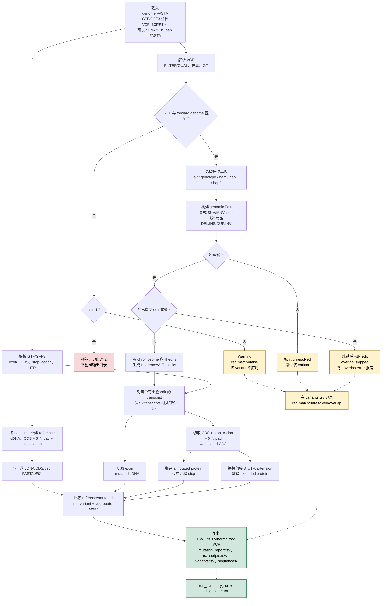

# mutatedSequence

[English](README.md) | **简体中文**

**从 VCF + Ensembl 注释生成等位基因感知的突变后 transcript、CDS 和蛋白序列。**

这个仓库最初是 2023 年的 bcftools/`seqkit` 流程，现在已重写为 genome-first
block 模型：先按基因组坐标应用 SNP/MNV/indel/常见 SV，再切取 exon 和 CDS，
从而统一处理正负链、跨外显子变异、5' 部分模型、split stop codon 等情况。

Python 流水线**没有第三方运行时依赖**（Python ≥ 3.8）。旧 shell 脚本仅作为
deprecated 参考保留。

---

## 1. 定位：它是什么，不是什么

这是一个 **sequence builder**，不是 variant annotator，也不是临床分级工具。
输入是**一个样本**的 VCF、匹配的 genome FASTA 和 Ensembl 风格 GTF/GFF3，
输出每条转录本的 reference/mutated cDNA、CDS、蛋白和基因组区域。

**适合：**

- 需要完整 cDNA/CDS/蛋白，而不只是 `c.`/`p.` 注释；
- 需要每个 variant 一行、带原始 REF/ALT 和 before/after 序列的审计表；
- 需要负链、跨 exon junction、whole-exon deletion、partial model、split stop；
- 需要显式控制 ALT/genotype/overlap，以及常见符号型 SV；
- 想要一个无依赖的 Python/Docker 工具。

**不适合替代 VEP/SnpEff 的场合：**

- 需要 population/clinical/regulatory/domain 注释；
- 需要 SIFT/PolyPhen/CADD/LOFTEE/SpliceAI 等预测；
- 需要真正的 phased compound haplotype（Haplosaurus/VCF2Prot 更强）；
- 需要 genome assembly 或 TRA/BND/CNV 重建；
- 需要 HLA/neoantigen（pVACseq）或 RNA reads 证据（Isovar）。

### 功能一览

| 能力 | 状态 |
|---|---|
| 完整 cDNA、CDS、annotated protein、3' extended protein | ✅ |
| SNV、MNV、indel、complex replacement | ✅ |
| 负链基因 | ✅ 已测试 |
| 跨 exon junction / intron / whole-exon deletion | ✅ genome-first block |
| 5' partial N pad、split stop codon、stop-loss readthrough | ✅ 已测试 |
| 多等位 / phased GT | ⚠️ 一个 consensus 选一个 ALT；`hap1`/`hap2` 按 GT 顺序；不推断 phase |
| 真正 phased compound haplotype | ❌ 需要先 phasing；Haplosaurus/VCF2Prot 更强 |
| splice-site / exon-skipping 建模 | ❌ splice 只注释，exon 结构固定 |
| `<DEL>/<INS>/<DUP>/<INV>` | ⚠️ 支持但有边界；TRA/BND/CNV 不支持 |
| clinical/population/regulatory/HGVS 注释 | ❌ 用 VEP/SnpEff/Mutalyzer |
| Docker 环境镜像 | ✅ 代码通过 `-v` 挂载 |
| 蛋白组/队列规模与性能基准 | ⚠️ Python 单进程；未与 Rust/C 工具做 head-to-head |
| 遗传密码 | ⚠️ 仅标准核密码 |

## 工作流程



虚线表示 warning/skip/reporting 路径。流程图假设注释和 transcript 结构固定；
真正的 phasing、splicing、TRA/BND/CNV 等不在模型内，详见
[明确无法处理的情况](#9-明确无法处理的情况重点)。

---

## 动画短片

仓库里有一支 7 分 26 秒、1080p/30fps 的 Remotion 流程动画，源码在
[`animation/`](animation/)。旁白使用中文女声 `zh-CN-XiaoyiNeural`
（rate -6%，pitch +2Hz），十三个镜头按实际配音时长剪辑。

- 分镜与导演说明：[`animation/STORYBOARD.md`](animation/STORYBOARD.md)
- 源码与渲染说明：[`animation/README.md`](animation/README.md)
- 在线观看：https://wenyuhaokikika.github.io/2026/10/24/mutatedsequence-vcf-to-transcript-protein/
- 渲染：`cd animation && ./render.sh` → `animation/out/explainer.mp4`
- 内容包括：WGS→AI 的缺口、菜谱比喻、输入、REF 校验、等位基因、genomic blocks、
  cDNA/CDS/蛋白、终止密码子失灵、可审计 TSV、Docker 用法、工具对比、
  诚实边界和结尾。

## 2. 安装


```bash
# Python >= 3.8，无第三方运行时依赖
python -m pip install -e .

# 或者直接在仓库根目录运行
python -m mutatedseq --help
./mutatedSequence --help
```

可选工具：

| 工具 | 用途 |
|---|---|
| `samtools` | 构建/使用 `.fai`，低内存随机访问 |
| `bcftools` | 交叉检查 `normalized.vcf` |
| `tabix` / `bgzip` | 大 VCF/FASTA 索引 |
| `seqkit` | 仅旧 legacy 脚本使用 |

### 参考数据

下载**同一 Ensembl release、同一 assembly** 的 genome、GTF、cDNA、CDS、pep：

```bash
./downLoad.sh 109
# 或使用亚洲镜像：
ENSEMBL_FTP=https://ftp.asia.ensembl.org/pub ./downLoad.sh 109
```

人类全基因组如果使用 `.gz`，会被读入内存。建议解压并建立 `.fai`：

```bash
gunzip -c resource/Homo_sapiens.GRCh38.dna.toplevel.fa.gz \
  > resource/Homo_sapiens.GRCh38.dna.toplevel.fa
samtools faidx resource/Homo_sapiens.GRCh38.dna.toplevel.fa
```

未压缩 FASTA 如果缺少 `.fai`，工具会自动构建。小测试数据可以直接用 `.gz`。

---

## 3. Docker：镜像只含环境，代码用 `-v` 挂载

镜像里**没有项目代码**，只有 Python 3.12、samtools、bcftools、tabix/bgzip、
wget/curl 等运行环境。代码必须挂载到 `/workspace`。

本地已验证：不挂载代码时 `python -m mutatedseq` 会报
`No module named mutatedseq`；挂载后 10 个测试通过。

### 预构建镜像（Docker Hub）

镜像已发布到
[`wenyuhaobuemoji/mutatedsequence`](https://hub.docker.com/r/wenyuhaobuemoji/mutatedsequence)：

```bash
docker pull wenyuhaobuemoji/mutatedsequence:2.0.0
docker run -it --rm \
  -v "${PWD}:/workspace" \
  -w /workspace \
  wenyuhaobuemoji/mutatedsequence:2.0.0
```

标签：`2.0.0` 和 `latest`。镜像仍然**只含环境**，代码通过 `-v` 从宿主机
挂载到 `/workspace`。下面的构建步骤只在你需要自己构建时使用。后续示例里的
`mutatedsequence:2.0.0` 可以替换为
`wenyuhaobuemoji/mutatedsequence:2.0.0`。

### 构建

```bash
docker build -t mutatedsequence:2.0.0 -t mutatedsequence:latest .
```

`.dockerignore` 只允许 `Dockerfile` 进入构建上下文，代码不会被误打包。

### 交互式：`docker run -it --rm`

Linux / macOS / PowerShell：

```bash
docker run -it --rm \
  -v "${PWD}:/workspace" \
  -w /workspace \
  mutatedsequence:2.0.0
```

Windows `cmd.exe`：

```bat
docker run -it --rm -v "%cd%:/workspace" -w /workspace mutatedsequence:2.0.0
```

Git Bash（需要关闭 MSYS 路径转换）：

```bash
MSYS_NO_PATHCONV=1 docker run -it --rm \
  -v "$(pwd -W):/workspace" \
  -w /workspace \
  mutatedsequence:2.0.0
```

进入容器后：

```bash
python -m mutatedseq --version
python -m mutatedseq run \
  -g tests/data/test.fa \
  -a tests/data/test.gtf \
  -v tests/data/test.vcf \
  -o tests/docker_out \
  --cds tests/data/test.cds.fa \
  --cdna tests/data/test.cdna.fa \
  --pep tests/data/test.pep.fa \
  --sample S1
exit
```

### 一次性命令

```bash
docker run --rm \
  -v "${PWD}:/workspace" \
  -w /workspace \
  mutatedsequence:2.0.0 \
  python -m mutatedseq run \
    -g tests/data/test.fa \
    -a tests/data/test.gtf \
    -v tests/data/test.vcf \
    -o tests/docker_out \
    --sample S1
```

Git Bash 同样加 `MSYS_NO_PATHCONV=1`，并把挂载路径写成 `"$(pwd -W):/workspace"`。

### 容器内测试

```bash
docker run --rm -v "${PWD}:/workspace" -w /workspace mutatedsequence:2.0.0 \
  python -m unittest tests.test_pipeline -v
```

### 权限和参考数据

- 默认用户 `mutant`，UID/GID 1000。
- Linux 宿主机 UID 不是 1000 时，加 `--user "$(id -u):$(id -g)"`，避免输出文件
  变成 1000 所有。
- Windows/macOS Docker Desktop 默认通常可用；如果挂载不可写，使用 `--user root`
  或换一个可写挂载目录。
- 参考数据在 repo 外时，再挂一个目录，例如
  `-v "/data/ensembl:/data/ensembl"`，命令里用 `/data/ensembl/...`。
- 人类基因组不要打进镜像；挂载解压后的 FASTA + `.fai`。

### 保存/加载镜像

```bash
docker save mutatedsequence:2.0.0 | gzip -9 > mutatedsequence-2.0.0.tar.gz
docker load -i mutatedsequence-2.0.0.tar.gz
```

本地构建的镜像约 205 MB；`dist/mutatedsequence-2.0.0.tar.gz` 约 49 MB
（`dist/` 被 gitignore，若不存在请自行 `docker save`）。

镜像内容：

| 工具 | 版本（本次构建） |
|---|---|
| Python | 3.12.15 |
| samtools | 1.16.1 |
| bcftools | 1.16 |
| tabix / bgzip | 1.16 |
| wget / curl / less / procps | Debian bookworm |

`seqkit` 不在镜像中，它只被 deprecated 的旧 shell 脚本使用。

---

## 4. 快速开始：合成测试数据

测试数据覆盖 SNP/MNV/indel、正负链、跨外显子 deletion、partial model、
split stop、multiallelic/phased、overlap、符号型 SV 等。

```bash
# 1. 生成小测试 FASTA/GTF/VCF
python tests/make_test_data.py

# 2. 运行主流程
python -m mutatedseq run \
  -g tests/data/test.fa \
  -a tests/data/test.gtf \
  -v tests/data/test.vcf \
  -o tests/demo_out \
  --cds tests/data/test.cds.fa \
  --cdna tests/data/test.cdna.fa \
  --pep tests/data/test.pep.fa \
  --sample S1

# 3. 诊断 REF 偏移、N pad、非终止转录本
python -m mutatedseq diagnose \
  -g tests/data/test.fa \
  -a tests/data/test.gtf \
  -v tests/data/test.vcf \
  -o tests/demo_out/diagnostics \
  --cds tests/data/test.cds.fa \
  --cdna tests/data/test.cdna.fa \
  --pep tests/data/test.pep.fa

# 4. 测试
python -m unittest tests.test_pipeline -v
```

### 测试转录本

| Transcript | 链 | 场景 |
|---|---|---|
| `TX_A` | + | 3 个 exon；start-lost、missense、synonymous、nonsense、MNV、1-bp frameshift insertion、3-bp in-frame deletion、stop-lost、splice donor、5'/3' UTR、intron、跨 intron 的 650-bp deletion、重叠 deletion+SNV |
| `TX_B` | − | 2 个 exon；负链 missense/indel、splice acceptor、3' UTR、符号型 `<DEL>`/`<INS>` |
| `TX_C` | + | 5' partial (`mRNA_start_NF`)、1 个 N pad、missense/frameshift |
| `TX_D` | + | 3' partial (`mRNA_end_NF`)、无 stop；stop-gained、frameshift |
| `TX_E` | + | stop codon 跨 exon junction；stop-lost |
| `TX_G` | + | multiallelic `1/2`、phased 1&#124;0、`<DEL>/<INS>/<DUP>/<INV>`、explicit insertion、REF mismatch、LowQual、`0/0`、`./.` |

示例输出在 [`examples/demo_out`](examples/demo_out)，其中
`mutation_report.tsv` 包含完整 before/after 序列。

---

## 5. 输入

### Genome FASTA

- 标准 FASTA，可 `.gz`；全基因组建议未压缩 + `.fai`。
- 支持常见 contig 别名：`1`/`chr1`、`M`/`MT`/`chrM`。
- soft-masked 序列会统一大写。

### GTF/GFF3

- 使用 `gene`、`transcript`/`mRNA`、`exon`、`CDS`、`stop_codon`、
  `five_prime_utr`、`three_prime_utr`。
- `exon_number` 用于排序；缺失时按 genomic + strand 排序。
- 第一个 CDS 的 `frame` 用于 5' partial 的 N pad（没有 CDS FASTA 时）。
- 保留并报告 `mRNA_start_NF`、`mRNA_end_NF`、`cds_start_NF`、`cds_end_NF`、
  `NMD`、biotype 等。
- **Ensembl GTF 的 CDS 不包含 stop codon**；工具会补上 `stop_codon` 行。
  如果 GTF 已经把 stop 放进 CDS，会检测重叠，避免重复。

### VCF

- `REF/ALT` 按 **forward strand** 解释。
- 默认只用 `FILTER=PASS` 或 `.`；可用 `--include-filtered` 或
  `--filter-values LowQual,...` 改变。
- `--min-qual` 过滤 QUAL。
- `--sample` 选择一个样本（默认第一个）；无样本 VCF 也可以。
- `--allele-mode` 控制等位基因选择（见下）。
- 支持 `<DEL>/<INS>/<DUP>/<INV>` 的 `SVTYPE`、`END`、`SVLEN`、
  `LEFT_SVINSSEQ`、`RIGHT_SVINSSEQ`。
- `TRA/BND/CNV` 会标记 unresolved，不会静默应用。
- **REF 校验**：每条已解析记录都会和 forward genome 比较。默认 REF 不匹配时：
  - 打印 warning；
  - `ref_match=false`；
  - 该变异不应用；
  - 继续运行。
  `--strict` 时第一条 REF 不匹配就报错，退出码 2，且不创建空输出目录。
  检查发生在 allele 选择之前，因此 `0/0` 或 `./.` 的记录也会检查；
  被 FILTER 过滤掉的记录不会被解析，也就不会检查。

#### 等位基因模式

| VCF GT | `alt` | `genotype` | `hom` | `hap1` | `hap2` |
|---|---|---|---|---|---|
| `0/0` | skip | skip | skip | skip | skip |
| `0/1` | ALT | ALT | skip | ref | ALT |
| `1/0` | ALT | ALT | skip | ALT | ref |
| `1/1` | ALT | ALT | ALT | ALT | ALT |
| `1/2` | ALT1 | ALT1 | skip | ALT1 | ALT2 |
| `./.` | ALT（默认） | skip（除非 `--allow-missing-gt`） | skip | skip | skip |

未 phasing 的 `0/1` 用 `hap1`/`hap2` 时按 GT 顺序分配，这是约定，不是真实
单倍型。`--alt-index` 只影响多等位记录；双等位记录总是用唯一 ALT。

### 可选 Ensembl FASTA

| 文件 | 用途 |
|---|---|
| `cdna.all.fa.gz` | 校验重建 cDNA |
| `cds.all.fa.gz` | 权威 5' N pad + stop；校验 CDS |
| `pep.all.fa.gz` | 校验 annotated protein；按 header 里的 `transcript:` 映射 |

3' partial 模型的 pep 末端可能有差异，详见“验证”。

---

## 6. 输出

```text
out/
├── mutation_report.tsv       # 每个 variant × transcript 一行
├── transcripts.tsv           # 每个 transcript 一行
├── variants.tsv              # 每个 VCF 记录/选中 ALT 一行
├── normalized.vcf            # 单 ALT、显式 REF/ALT
├── run_summary.json
├── diagnostics.txt
└── sequences/
    ├── transcripts.ref.fa / transcripts.alt.fa
    ├── cds.ref.fa / cds.alt.fa
    ├── cds_ext.ref.fa / cds_ext.alt.fa
    ├── proteins.ref.fa / proteins.alt.fa / proteins.changed.fa
    ├── proteins.extended.ref.fa / .alt.fa / .changed.fa
    ├── genomic_regions.plus.ref.fa / .alt.fa
    └── genomic_regions.transcript.ref.fa / .alt.fa
```

### `mutation_report.tsv`

每行是一个 variant × transcript。主要列：

| 列 | 含义 |
|---|---|
| `chrom`, `chrom_vcf`, `pos`, `id`, `ref`, `alt_all`, `alt_selected`, `allele_index`, `gt`, `phased`, `filter` | 原始 VCF + 选中等位基因 |
| `status` | `selected`、`hom_ref`、`overlap_skipped`、`unresolved` 等 |
| `ref_match`, `genome_ref`, `ref_offset`, `genome_context`, `ref_note` | REF 校验和偏移诊断 |
| `edit_kind`, `edit_start0`, `edit_end0`, `edit_length_delta`, `edit_note` | 归一化后的 genomic edit |
| `transcript_id`, `gene_id`, `gene_name`, `strand`, `exon_rank` | transcript 上下文 |
| `region`, `splice`, `consequence` | `exon_cds`、`exon_5utr`、`exon_3utr`、`intron`、`splice_donor` 等 |
| `cds_length_delta`, `cds_pos`, `protein_pos`, `codon_ref`, `codon_alt`, `aa_ref`, `aa_alt` | codon/AA 变化 |
| `stop_gained`, `stop_lost`, `start_lost` | 独立的 stop/start 标志 |
| `protein_diff_single`, `protein_ext_diff_single` | 只应用该 variant 的效果 |
| `protein_diff_aggregate`, `protein_ext_diff_aggregate` | 该 transcript 全部 variant 的效果 |
| `transcript_ref`, `transcript_alt` | 完整 cDNA before/after |
| `cds_ref`, `cds_alt` | annotated CDS before/after |
| `cds_ext_ref`, `cds_ext_alt` | CDS + 3' extension |
| `protein_ref`, `protein_alt` | annotated protein before/after |
| `protein_ext_ref`, `protein_ext_alt` | extended protein before/after |
| `reference_class`, `reference_stop_reason` | `complete`、`partial_3`、`partial_5_complete_3` 等 |
| `n_variants`, `variant_keys`, `transcript_notes` | 聚合信息 |

示例（测试数据，省略完整序列）：

| id | transcript | REF | ALT | GT | consequence | CDS Δ | protein pos | codon REF | codon ALT | aa REF | aa ALT | protein change |
|---|---|---|---|---:|---|---:|---:|---|---|---|---|---|
| A_missense | TX_A | C | A | 0/1 | missense | 0 | 11 | CTG | ATG | L | M | p.Leu11Met |
| A_nonsense | TX_A | A | T | 1/1 | nonsense | 0 | 30 | AAA | TAA | K | * | p.Lys30_Asn233del |
| A_frameshift_ins | TX_A | T | TC | 0/1 | frameshift | +1 | 41 | TAT | TCA | Y | S | p.Tyr41_Asn233delins3aa |
| A_stop_lost | TX_A | T | C | 0/1 | stop_lost | 0 | 234 | TAA | CAA | * | Q | p.234_235insGln |
| B_missense | TX_B | G | T | 1/1 | missense | 0 | 11 | CTG | ATG | L | M | p.Leu11Met |
| G_multiallelic | TX_G | C | A | 1/2 | missense | 0 | 95 | CAA | AAA | Q | K | p.Gln95Lys |

`B_missense` 是负链：VCF ALT 是 forward 的 `T`，转录本上反向互补成 `ATG`。

### `transcripts.tsv`

每个 transcript 一行：聚合 flags、长度、序列（除非
`--no-sequences-in-tsv`）、`cdna_matches_ensembl`、`cds_matches_ensembl`、
`protein_matches_ensembl`、`protein_diff`/`protein_ext_diff` 等。

### `variants.tsv`

每个已解析 VCF 记录一行：选中 ALT、REF 校验、`n_transcripts`、相关
genes/transcripts、status。没有命中 transcript 的变异也保留。

### `normalized.vcf`

每个记录只保留一个 ALT。SNV/indel 原样；`<DEL>` 写成 anchor+deleted REF /
anchor ALT；`<INS>` 写成 `anchor -> anchor+inserted`；`<DUP>` 写成重复区间后的
插入；`<INV>` 写成显式反向互补替换。INFO 增加 `ORIG_ALT`、`ORIG_GT`、
`ALLELE_INDEX`、`EDIT_KIND`。Unresolved 符号型等位基因不写出。

### annotated vs extended protein

- `proteins.*`：**annotated CDS** 翻译，停在注释 stop。
- `proteins.extended.*`：**CDS + 剪接 3' UTR**（最多 `--extend-bp`）翻译，
  用于 stop-loss/readthrough 和 3' 端不完整模型。
- `--extend-mode`：
  - `utr`（默认）：剪接 3' UTR；
  - `utr+genomic`：3' UTR 后再接 genomic downstream；
  - `genomic`：旧行为，未剪接的 genomic 序列（可能含 intron）；
  - `none`：不延伸。

---

## 7. 算法

### 坐标约定

- VCF：1-based POS；REF/ALT forward strand。
- GTF：1-based，闭区间。
- 内部 block：0-based，半开区间。
- Transcript/CDS/protein：5'→3'；负链 exon 反向互补。

### Genome-first block

每个 chromosome 的 accepted variants 变成
`(ref_start0, ref_end0, alt)`。`MutatedRegion` 是 block 列表：

```text
reference block [start, end)  -> 从 genome fetch
alternate block [start, end)  -> ALT（空 = deletion）
insertion block [p, p)        -> inserted sequence
```

exon/CDS 和 block 求交。这样可以：

- 正确处理 `REF=T, ALT=TC` 这类 insertion（返回完整 `TC`，不是只返回 `T`）；
- deletion 跨 intron 时只删除 exonic 部分；
- 整个 exon 被删除时，剩余 exon 正确拼接；
- 负链先取 plus-strand block，再对 exon/CDS 整体反向互补。

### Reference 重建

1. 按 transcript 顺序拼接 GTF CDS；
2. 确定 5' N pad：
   - 有 Ensembl CDS FASTA 时，用其 leading N；
   - 否则 partial-start 用 `(3 - first_CDS_phase) % 3`；
3. 加 `stop_codon`（若 CDS 已包含则跳过）；
4. 若 Ensembl CDS 比重建结果长 1–3 bp，且多出的碱基与 genome 上 coding end
   之后立即的序列匹配，则推断这些碱基；更大差异只报告，不猜；
5. 拼接 3' UTR 或请求的 extension；
6. 分别翻译 annotated 和 extended 序列。

结果会和提供的 cDNA/CDS/pep 校验，并写入 TSV。

### 变异选择和 overlap

- 按 `--allele-mode` 选一个 allele；
- 符号型尽量转成显式 edit；
- REF 与 forward genome 比较；REF 长度 ≥2 时报告 ±window 偏移（单碱基
  mismatch 不做偏移搜索，避免随机假偏移）；
- 排序后按 `--overlap skip|error` 处理 overlap；
- accepted edits 应用到 blocks；rejected 写 `overlap_skipped`。

### Effect 注释

- `fast`：SNV 用 codon mapping；indel 粗分类；
- `full`：只用该 variant 重建 transcript CDS 并比较蛋白，精确处理
  MNV/indel/stop/start/负链；
- `off`：只给位置；
- `auto`：≤20,000 条 VCF 用 `full`，否则 `fast`。

per-variant 是“单独应用该 variant”的效果；aggregate 是“该 transcript 所有
accepted variants 一起”的效果，两者可能不同。

### 为什么不再用 bcftools consensus + 逐 exon？

旧方法无法：

- 处理跨 exon junction 的 variant（REF 包含 intron，但 per-exon FASTA 没有）；
- 处理负链（record 已反向互补，VCF allele 是 forward）；
- 一致处理 multiallelic/phased；
- 应用 `<INS>/<DUP>/<INV>`（bcftools 只支持 `<DEL>/<*>/<NON_REF>`）；
- 正确做 3' UTR readthrough（旧 5 kb genomic tail 含 intron）。

新工具用 genome-first block，并写 `normalized.vcf` 供 bcftools 交叉检查。

---

## 8. 三个问题的详细回答

### 8.1 为什么 REF 看起来错位，参考序列前面多 1–3 个 X/N？

`createDB.py` 里：

```python
a = 从 genome 切出的 CDS（GTF CDS 拼接）
b = Ensembl CDS FASTA
mode = b.replace(a, 'X')
```

`X` 不是碱基，也不是 alignment。若 `b = a + "TAG"`，`mode = "XTAG"`；
X 在替换串的开头，但多出的 3 个碱基是 **3' 端 stop codon**。
若 `b = "NN" + a + "TAG"`，`mode = "NNXTAG"`：2 个 N 是 5' partial codon
的 padding，X 替代匹配部分，`TAG` 是 stop。

真实 Ensembl 109 chr21 例子：

| Transcript | Raw GTF CDS | Ensembl CDS | 差值 | 解释 |
|---|---:|---:|---:|---|
| `ENST00000432178` (CCT8) | 319 | 324 | +5 | 5' 2 个 N（`NNTGAG...` vs `TGAG...`）+ 3' stop |
| `ENST00000460679` (JAM2) | 782 | 786 | +4 | 5' 1 个 N + 3' stop |
| `ENST00000284885` (TMPRSS15) | 3057 | 3060 | +3 | 无 N；仅 3' stop |
| `ENST00000381284` (ITSN1) | 949 | 951 | +2 | 5' 2 个 N；无 stop（partial 5'/3'） |
| `ENST00000431234` (CCT8) | 968 | 969 | +1 | 5' 1 个 N；无 stop（partial 5'/3'） |

chr21 全部 1,050 条 CDS transcript：

```text
raw length difference (Ensembl - raw GTF CDS):
  +3: 831   0: 136   +5: 40   +4: 29   +1: 8   +2: 6
leading N count in Ensembl CDS: 0: 967, 1: 37, 2: 46
Ensembl CDS terminal codon: stop: 900, no_stop: 150
```

所以“前面多 1–3 个 X/N”的真实来源是：

- 5' partial model 的 1–2 个 N；
- 3' 端 stop codon（GTF CDS 不含，CDS FASTA 含）；
- 旧 `mode` 的 X 占位符让 3' 多出的碱基看起来像“前面多出来”。

VCF REF 排查：

- VCF REF/ALT 是 forward strand；负链转录本要反向互补；
- indel 的 POS 是 anchor；`REF=AT, ALT=A` 删除的是 POS+1 的 T；
- VCF 可能 left-align/trim，重复区域里同一事件可写在不同的 POS；
- 比较时大小写：`dna_sm` 是 soft-masked，工具内部会大写；
- 不同 assembly/release 或 contig 命名会产生大量 mismatch；
- transcript/CDS 坐标的 VCF 不能当成 genomic VCF 用。

新增 `diagnose`：

```bash
python -m mutatedseq diagnose \
  -g genome.fa -a annotation.gtf -v sample.vcf -o diag \
  --cds cds.all.fa.gz --pep pep.all.fa.gz
```

`--strict` 可让 REF mismatch 直接报错；默认 warning + skip。

### 8.2 为什么很多转录本没有以 stop codon 结束？

Ensembl 109 的 121,766 条 CDS：

```text
terminal TAA/TAG/TGA:      99,812  (81.97%)
no terminal stop:          21,954  (18.03%)
strict in-frame stop:      99,054  (81.35%)
out-of-frame stop triplet:    758
```

21,954 条无 terminal stop 中：

- **18,559** 带 `mRNA_end_NF`：3' 不完整，stop 在已知转录本外；
- **2,614** 带 `mRNA_start_NF`：5' 不完整（可与 end_NF 重叠）。

另外 **758** 条以 stop triplet 结尾，但 CDS 长度不是 3 的倍数，即不在阅读框内。
严格无框内 stop 的集合是 **22,712**（21,954 + 758）。其中非编码/特殊类别：

- **~574** 个 IG/TR V/D/J 基因片段，本来就不是完整蛋白；
- **114** 个 `non_stop_decay`，无 stop，被 NSD 降解；
- **62** 个 `protein_coding_LoF`、**20** 个 NMD/partial，以及少量 pseudogene/
  readthrough 模型；
- 其余大多数是 `protein_coding` 的 partial model。

这些 tag/biotype 有重叠，不要直接相加。

生物学/注释原因：

- NMD 转录本可能有 premature stop，不一定是全长蛋白；
- NSD 转录本无 stop，翻译进入 poly(A)；
- `cds_start_NF`/`cds_end_NF` 等 partial model 因证据不完整；
- 免疫受体 V/D/J 片段不是完整蛋白；
- 硒蛋白 TGA 编码 Sec，naive translation 会当成 stop；
- readthrough、programmed frameshifting 是罕见生物学例外；
- stop codon 跨 exon junction 时，检查最后一个 genomic exon 可能漏掉。

旧流程的技术问题会让“非终止”统计偏高：

- GTF CDS 不含 stop；只拼 CDS 不补 `stop_codon`，所有转录本都“没有 stop”；
- `isStopWithCodon` 强制 `len(seq) % 3 == 0`，正确排除 758 个伪 stop，但把
  partial model 都标成 non-stop；
- `giveMode` 返回 NaN 时 `isStopWithCodon` 返回 `None`（falsy）；
- `tailCdsSeq` 使用全局 `end`，负链时读错 3 个碱基；
- 5 kb extension 是 **genomic**，不是剪接 3' UTR，会包含 intron；
- 旧流程只延伸 stop-ending，非 stop 不延伸。

新工具输出 `reference_class` 和 `reference_stop_reason`，不强行要求 stop；
partial model 翻译到可用结尾，stop-loss/frameshift 用 extended protein 找下一个
in-frame stop，并报告 `protein_ext_stop_*`。

### 8.3 等位基因、genotype 和 SV 要注意什么？

- 不要盲目应用所有 ALT，必须按 `GT`/phase 选。
- 支持 `--allele-mode alt|genotype|hom|hap1|hap2`。
- `0/0` 跳过；`./.` 在 `alt` 模式默认应用，在 `genotype` 模式默认跳过
  （`--allow-missing-gt` 可改）。
- `1/2`：一个 linear consensus 只能选一个 ALT；`alt` 取 ALT1，
  `hap1`/`hap2` 分别取两个；要两个真实单倍型就分别跑两次。
- 重叠变异：默认跳过后来的，TSV 标记 `overlap_skipped`；`--overlap error`
  直接报错。
- 符号型 SV：
  - `<DEL>`：POS anchor，END 最后一个被删碱基，SVLEN 负；
  - `<INS>`：用 `LEFT_SVINSSEQ` 或 `RIGHT_SVINSSEQ`，维护者建议只用一个；
    SVLEN 可能只是估计；
  - `<DUP>`：按 tandem duplication 处理，在 END 后插入；
  - `<INV>`：反转 POS+1..END；
  - `<TRA>/<BND>/<CNV>`：无法表示成一条 linear transcript，标记 unresolved。
- bcftools consensus 只原生支持 `<DEL>/<*>/<NON_REF>`，不支持
  `<INS>/<DUP>/<INV>`；这正是 dysgu issue #65 的核心。
- dysgu #63：`SVLEN` 是 START/END 差值，不是“改变碱基数”。
- dysgu #68/#79：运行时 `OverflowError`/`pickle.UnpicklingError`，是
  dysgu 进程/内存问题，升级、减少 `--procs`、增加内存；不影响本工具对正确
  VCF 的解释。
- 肿瘤/CCLE：单 consensus 是简化；肿瘤异质性、subclone、VAF 需要 clone/
  haplotype-specific 分析；至少做 phasing 或长读长组装。

---

### 终止密码子失灵 / readthrough

会处理。若注释的终止密码子被替换或删除，突变后的 CDS 仍在原阅读框内翻译。
默认会继续翻译到**剪接后的 3′ UTR**，上限由 `--extend-bp` 控制（默认 5000）：

- 找到下一个 in-frame stop：extended protein 在那里结束
  （`protein_ext_stop=true`）；
- 一直没找到 stop：翻译到可用延伸序列的终点，TSV 标记
  `stop_lost=true`、`protein_ext_stop=false`；不会假装旧 stop 还在。

它**不会无限翻译整条染色体**。如果下一个 stop 在注释转录本之外，可用
`--extend-mode utr+genomic`/`genomic` 或增大 `--extend-bp`；`genomic` 可能包含
intron。`--extend-mode none` 则停在注释 CDS 末端。参考本身就没有 stop 的
partial_3 模型没有“stop 可失去”；突变新产生 stop 会标记为 `stop_gained`。

## 9. 明确无法处理的情况（重点）

这一节尽量直白。遇到以下情况，不要假设工具“默默做对了”：检查
`variants.tsv` 的 `status`/`ref_match`、`transcripts.tsv` 的
`reference_class`，或看 run warning。

### 9.1 快速对照表

| 情况 | 工具行为 | 建议替代方案 |
|---|---|---|
| 未 phasing 的 compound variants，或不同 haplotype 上 overlapping variants | 生成一个 **mosaic** consensus；后一个 overlapping edit 被 skip（`overlap_skipped`） | 先 phasing；跑 `hap1`/`hap2`；用 Haplosaurus/VCF2Prot 做 phased compound |
| 一个位点两个 ALT（`1/2`） | 每次只选一个 ALT；`hap1`/`hap2` 分别取两个 | 跑两次，或用 phased haplotype |
| splice-site 导致 exon skipping/cryptic splice/intron retention | splice region 会注释，但 exon 结构固定；cDNA/CDS 可能不变 | VEP + SpliceAI/MMSplice；手工构建 alternative transcript |
| alternative promoter/polyA/最后 exon | 不建模，固定注释 | 替代 GTF/转录本模型；RNA 专用工具 |
| NMD | `reference_class` 会标 NMD/partial，但不套 NMD 规则 | VEP/LOFTEE/NMD 专用工具 |
| `<TRA>/<BND>/<CNV>` | unresolved + skip | assembly/pangenome、AnnotSV、Varcode、vcf2diploid |
| breakend ALT（`N[chr:pos[`） | unresolved + skip | 转成显式序列或用 SV 工具 |
| `<INS>` 没有 `LEFT/RIGHT_SVINSSEQ` | unresolved，不能凭空生成插入序列 | assembly-based insertion |
| 非 tandem/interspersed `<DUP>` | 近似成 tandem duplication | assembly/VCF re-representation |
| 复杂/多 breakpoint `<INV>` | 只做简单区间反转 | assembly/pangenome |
| `<DEL>/<INS>/<DUP>/<INV>` 的 `END`/`SVLEN` 不一致 | 按 END/SVLEN 启发式处理并记录 note；可能 unresolved | 用 caller/bcftools 归一化/校验 VCF |
| `<NON_REF>`、`<*>`、gVCF reference block | skip | 转成普通 VCF |
| 线粒体遗传密码 | 使用标准核密码 | 线粒体专用注释/翻译 |
| 硒蛋白（TGA）/吡咯赖氨酸 | TGA/TAG 当 stop | SECIS/Pyl-aware 工具 |
| alternative start codon（CTG/TTG/GTG） | 按标准氨基酸翻译，first residue **不强制为 M** | 手工检查或专用注释工具 |
| programmed frameshift / 生物 readthrough | 不建模为生物 recoding；3' extension 只做序列层面的 stop-loss 翻译 | 专用工具/手工 |
| 多样本 VCF/队列 | 每次一个 sample | 逐样本循环；蛋白组规模用 VCF2Prot |
| somatic VAF/subclone/肿瘤异质性 | 一个 consensus | clone/haplotype-specific，read-backed phasing |
| 多倍体 | 只按 diploid/haploid GT 约定；不建模 polyploid | 多倍体专用工具 |
| BCF/MAF/gVCF | 不接受；只接受 VCF text/`.vcf.gz` | 转成 VCF |
| transcript/CDS 坐标的 VCF | REF 与 genome 不匹配；warning/skip（或 `--strict` 报错） | 转成 genomic 坐标/liftover |
| VCF 与 genome/GTF 不同 assembly/release | 大量 REF mismatch；warning/skip 或 `--strict` 报错 | 统一 assembly/release |
| genome FASTA 缺少 alias/patch/haplotype contig | 相关 transcript 被丢弃；variant 可能 unresolved | 使用匹配的 toplevel/primary assembly |
| 被 FILTER 过滤掉的记录 | 默认不解析、不校验、不应用 | `--include-filtered`/`--filter-values`，再检查/`--strict` |
| 超大 VCF/队列 | Python 单进程；`full` 可能慢；完整序列 TSV 很大 | `--per-variant fast/off`、`--no-sequences-in-tsv`、按 chromosome 拆分、与 Rust/C 工具对比 |
| whole-chromosome mutated FASTA | `--write-mutated-genome` 可选，但内存/磁盘大 | 按区域生成，或 `bcftools consensus` |
| replacement block 只和 exon 部分重叠 | ALT 线性切片近似，不是 base-level 映射 | 手工检查；拆成更小的显式 edit |
| insertion 正好在 exon/intron 边界 | 边界包含是约定，生物学解释有歧义 | 检查采用的边界规则，调整 VCF 表示 |
| protein domain/PTM/结构/信号肽 | 不注释 | InterPro/Pfam/UniProt/ProtVar |
| HLA/neoantigen ranking | 不支持 | pVACseq/pVACtools、NetMHCpan、MHCflurry |
| RNA 表达/read 证据 | 不使用，纯注释 | Isovar、RNA-seq 流程 |
| clinical/population/regulatory 注释、HGVS `c./p.` | 不支持（只有简单 protein diff） | VEP、SnpEff、Mutalyzer、ClinVar/gnomAD |

### 9.2 Phasing、compound allele 和 ploidy

`hap1`/`hap2` 按 `GT` 里的等位基因顺序取。未 phasing 的 `0/1` 是任意分配，
不是生物单倍型。工具不从 reads/linkage 推断 phase，也不建 haplotype tree。
两个 overlapping variants（例如 deletion 和里面的 SNV，或同一位点两个不同
ALT）无法合成一个 linear consensus；默认 skip 后一个。相邻、非重叠的 variants
会组合，但这不是完整 phased haplotype construction。

因此：

- `1/2` 不能在一个序列里同时表示两个 ALT；
- cis 的 compound allele 如果需要合并 overlapping 记录，不支持；
- trans 的 compound allele 在未 phasing 时无法与 mosaic 区分；
- polyploid GT、somatic VAF、subclone 不建模。

**建议：** 用 SHAPEIT/Beagle/WhatsHap/长读长先 phasing，再跑 `hap1`/`hap2`；
phased CDS SNV/indel haplotype 用 Haplosaurus 更成熟；蛋白组规模用 VCF2Prot。

### 9.3 Splicing 和 transcript structure

工具假设 GTF/GFF3 的 exon/CDS 坐标固定且正确。它把 variant 应用到 genome，
再按注释切 exon。它**不建模**：

- exon skipping/inclusion；
- cryptic splice donor/acceptor；
- intron retention；
- alternative 5'/3' splice site；
- alternative promoter/polyA；
- novel exon 或 de novo transcript assembly；
- 基于 exon junction 位置的 NMD 规则。

splice-site variant 会报告 `splice_donor`/`splice_acceptor`，也可能改变基因组
序列，但 cDNA/CDS 仍用原 exon 边界。如果真实效应是 exon skipping，本工具
**不会**显示 skipped isoform。VEP/SnpEff 注释 splice consequence；
SpliceAI/MMSplice 预测 splice disruption；它们也不会自动生成所有 alternative
transcripts。需要 alternative annotation/assembly 或转录本建模工具。

### 9.4 结构变异和复杂等位基因

支持但有边界：

- `<DEL>`：POS anchor，END 最后一个被删碱基，SVLEN 负；删除 POS+1..END；
- `<INS>`：使用 `LEFT_SVINSSEQ` 或 `RIGHT_SVINSSEQ`；两者都没有则 unresolved；
  `SVLEN` 不优先于实际序列；
- `<DUP>`：假设 **tandem** duplication，插到 END 后；
- `<INV>`：简单反转 POS+1..END。

不支持：

- `<TRA>`、`<BND>`、`<CNV>`、breakend ALT；
- 多 breakpoint 的复杂重排；
- 非 tandem/interspersed duplication；
- 不是简单区间的 inversion；
- 需要 assembly 才能得到完整序列的 insertion；
- 无法在一条 linear consensus 上应用的 overlapping SV；
- SV 的 haplotype phasing；
- 只有近似 END/SVLEN 的 whole-chromosome/whole-transcript deletion；
- 线粒体/染色体外/环状基因组重建。

这些会标记 `unresolved` 并 skip（或计入 `run_summary.json`），不会乱猜。
用 assembly/pangenome、AnnotSV/Varcode 做 SV 注释，或 vcf2diploid 做
genome-level haplotype。

### 9.5 遗传密码和蛋白生物学

翻译使用**标准核遗传密码**，不处理：

- 脊椎动物线粒体密码（AGA/AGG stop、TGA Trp）；
- 硒代半胱氨酸（SECIS）或吡咯赖氨酸（PYLIS）；
- alternative start codon 被生物学翻译成 M；
- programmed ribosomal frameshifting；
- 生物 stop-codon readthrough（3' extension 只是序列层面的 readthrough 模型，
  不是 recoding 预测）；
- signal peptide、跨膜区、domain、PTM、结构；
- NMD/NSD 的生化半衰期。

**建议：** 线粒体/硒蛋白用专门的 genetic-code-aware 工具；NMD 用 VEP/LOFTEE；
蛋白注释用 InterPro/Pfam/UniProt/ProtVar。

### 9.6 Reference 和 annotation mismatch

- VCF、genome、GTF 必须同一 assembly/release。GRCh37 VCF + GRCh38 genome
  会产生大量 REF mismatch，工具不会自动修复。
- 常见 contig alias（`1`/`chr1`、`M`/`MT`/`chrM`）会解析；任意别名、FASTA
  里没有的 patch/haplotype contig、改过名的 contig 不会。
- **没有 liftover**；请先统一 reference 或 liftover。
- **没有 variant normalization/left-alignment**；请先
  `bcftools norm -f genome.fa`（并检查 `-c s`）。
- 不自动选择 MANE Select/canonical/RefSeq；所有选中 transcript 都处理，用
  `--transcripts`/`--biotypes` 自己筛。
- 处理 Ensembl GTF 约定（CDS 不含 stop、`stop_codon`、5' phase/N pad）；
  其他注释特殊约定不一定处理。若重建和提供的 CDS FASTA 差异超过支持的
  1–3 bp 推断，只报告，不猜。
- transcript/CDS 坐标的 VCF 不能当成 genomic 使用；先转坐标。
- GTF/CDS release 必须和 genome/VCF 匹配，否则 transcript 序列和 REF 校验
  会对不上。

### 9.7 Sample、genotype 和记录级限制

- 每次 run 只选一个 sample（`--sample`；默认第一个）；没有多样本/队列单文件输出。
- `0/0` skip；`./.` 在 `alt` 模式默认应用，在 `genotype` 模式默认 skip
  （除非 `--allow-missing-gt`）。
- 被 FILTER 过滤的记录默认不解析；`--strict` 只能检查已解析记录，不能检查
  被 FILTER 丢掉的记录。
- `--alt-index` 只对多等位记录生效；每次只选一个 ALT。
- overlapping edits 默认 skip，不 merge；transcript report 显示
  `overlap_skipped`。
- 工具不 call variant、不 phasing、不 assembly、不用 BAM/RNA 证据。

### 9.8 规模、I/O 和证据

- 输入 VCF 是 text/`.vcf.gz`；**不接受 BCF/MAF/gVCF**。
- `.gz` genome 会读入内存；人类基因组请解压 + `.fai`。
- Python 单进程；适合 exome、选定 transcript、或中等规模 WGS 子集；不是
  proteome-scale 流水线；没有和 Rust/C 工具的 head-to-head benchmark。
- 每个 TSV 行都带完整序列会很大；用 `--no-sequences-in-tsv` + FASTA。
- 没有 BAM/RNA/ribosome profiling、HLA typing、表达定量、临床数据库、
  population frequency、regulatory track、蛋白结构集成。
- `--write-mutated-genome` 可能很吃内存/磁盘；优先 per-region 或
  `bcftools consensus`。

### 9.9 边界和近似情况

这些不一定是“完全不支持”，但属于近似，需要检查：

- insertion 正好在 `exon.start`/`exon.end`：边界包含是约定，可能和真实
  splice boundary 解释不同；
- replacement block 只和 exon 部分重叠：ALT 线性切片，不是 base-level edit
  map；复杂 deletion/replacement 在 exon 边界可能不精确；
- `--extend-mode genomic` 故意使用未剪接 genomic 序列（含 intron），这是旧
  5 kb tail 行为，不是 transcript model；
- 大 deletion 可能删掉整个 transcript/exon，结果可能为空或很短；检查
  `cdna_length_alt`/`cds_length_alt`；
- 一个 transcript 多个 variants 时，per-variant effect 是单独应用该 variant
  的结果，aggregate 是全部 accepted variants 的结果，二者可能不同；
- overlapping variants 不会自动合并。需要 compound haplotype 时，先 phasing
  并在外部合并，或用 Haplosaurus/VCF2Prot。

---

## 10. 与类似工具对比

这是 **截至 2026-10 的功能/文档对比**，不是同一数据集上的 accuracy/runtime
benchmark。工具都在演进，生产使用前请核对当前版本。

| 工具 | 类别 | 优点 | 局限 | 相对本工具 |
|---|---|---|---|---|
| **Ensembl VEP + Haplosaurus / ProteinSeqs** | 注释；Haplosaurus phased CDS/protein haplotype；ProteinSeqs 逐 variant 蛋白 FASTA | 成熟、快、注释生态强；Haplosaurus 能处理 phased compound CDS，并导出完整 CDS/protein haplotype | VEP 核心是注释；ProteinSeqs 不合并 variant，stop 处理简单；Haplosaurus 需要 phased VCF、以 CDS 为中心，公开对比指出 boundary/whole-exon deletion 限制；不重建 SV | 它们赢在注释、HGVS、真实 phasing；本工具赢在完整 cDNA、partial model、支持的 DEL/INS/DUP/INV 和 large deletion、审计 TSV |
| **bcftools csq** | VCF 内 haplotype-aware consequence 注释 | C 实现、非常快；compound/phased consequence；标准 VCF/BCF | 只支持 Ensembl GFF3；不输出完整 CDS/protein；不处理 SV/partial model | csq 赢在速度和标准注释；本工具赢在序列级输出 |
| **SnpEff `-fastaProt`** | 注释 + mutated protein FASTA | 快；预构建数据库多；`-fastaProtNoRef` | 注释中心；多 variant/compound 语义文档不明确；默认可能含 reference/空蛋白；不处理 cDNA/CDS/partial/SV | SnpEff 赢在数据库和速度；本工具赢在显式 allele/SV/partial 和完整序列 |
| **VCF2Prot** | 从 phased + bcftools-csq VCF 生成 personalized protein FASTA | Rust、蛋白组规模、按 haplotype 输出蛋白；论文称 99k variants/8,192 患者约 11 分钟 | 必须 phased flat VCF + bcftools csq；只输出蛋白，不输出 transcript/CDS；overlapping/多注释 transcript 会被丢弃；内存高；SV 支持未文档化 | VCF2Prot 赢在规模和 phasing；本工具赢在输入灵活性、cDNA/CDS、SV、逐 variant 审计 |
| **ORFan** | mutated transcripts + 三帧 ORF peptide | 最接近 transcript+peptide 的直接工具；Rust | 项目新/小；VCF 限 coding exonic；phasing/indel/SV/multiallelic 行为未文档化 | 本工具更稳健/完整；ORFan 适合专门找 ORF/peptide |
| **Varcode** | Python per-transcript effect；mutant protein sequence | 有 `mutant_protein_sequence`、SV 解析、multi-outcome、PyEnsembl | 是库不是完整报告；预测不等于表达证据；unknown phase 给多候选；依赖 annotation source | Varcode 赢在 API/effect 对象；本工具赢在 CLI、完整 cDNA/CDS、partial model、TSV |
| **Isovar** | 从 RNA-seq BAM + VCF 推断 mutant protein | 有 read-level/表达证据 | 需要 BAM/覆盖度；不是纯 VCF transcriptome builder | 互补：本工具注释层，Isovar 表达证据 |
| **Mutalyzer / TransVar** | HGVS 校验、gDNA/cDNA/protein 坐标注释 | Mutalyzer HGVS 权威；TransVar 坐标转换强 | Mutalyzer 偏单 variant/HGVS；TransVar 偏注释/坐标，不直接输出完整序列 | 它们赢在 HGVS/坐标；本工具赢在全 VCF 完整序列 |
| **pVACseq** | 新抗原/HLA peptide 预测 | 免疫学流程成熟；HLA binding/ranking | peptide 中心，不是完整 protein/transcript；需要 HLA/表达；MNP/indel 边界有已知问题 | 互补：本工具给完整蛋白，pVACseq 筛 epitope |
| **vcf2diploid** | 从 VCF 构建 diploid genome FASTA + chain/map | 处理 phasing/SV，全基因组层面 | 只到 genome；transcript/protein 要 liftOver/RSEQtools | 互补：genome-level vs transcript/protein-level |

### 是否比它们好？

**不是全面更好，而是补一个特定空位：**

- 需要 **完整 cDNA + CDS + annotated/extended protein**，不只是注释；
- VCF **未 phasing 或含支持的 SV/large deletion**；
- 需要 **partial model、5' N pad、split stop、负链**；
- 需要一张 **可审计 TSV**，含原始 REF/ALT 和 before/after 序列；
- 想要无第三方依赖的 Python/Docker 工具。

成熟工具更强的地方：

- **注释广度**：VEP/SnpEff（population/clinical/regulatory/
  SIFT/PolyPhen/CADD/LOFTEE/HGVS）；
- **真实 phased compound haplotype**：Haplosaurus/VCF2Prot；
- **速度/规模**：bcftools csq、VCF2Prot；
- **SV/复杂基因组**：assembly/pangenome、Varcode/vcf2diploid；
- **新抗原/HLA**：pVACseq；
- **RNA 证据**：Isovar；
- **HGVS 验证**：Mutalyzer。

对原始场景（unphased WGS cell-line VCF + dysgu SVs + 完整 transcript/protein +
partial model），本工具作为 **sequence builder** 比纯注释工具更合适；但要得到
真实单倍型，仍应先 phasing；要临床/regulatory 注释，仍应配 VEP。

### 工具链接

- [Ensembl VEP](https://www.ensembl.org/info/docs/tools/vep/index.html)
- [Haplosaurus](https://www.ensembl.org/info/docs/tools/vep/haplo/index.html)
- [VEP ProteinSeqs](https://github.com/Ensembl/VEP_plugins/blob/release/90/ProteinSeqs.pm)
- [bcftools csq](https://samtools.github.io/bcftools/howtos/csq-calling.html)
- [SnpEff](https://pcingola.github.io/SnpEff/snpeff/commandline/)
- [VCF2Prot](https://github.com/ikmb/vcf2prot)
- [ORFan](https://github.com/ngs-ai-org/orfan)
- [Varcode](https://github.com/openvax/varcode) · [docs](https://openvax.github.io/varcode/getting_started/)
- [Isovar](https://github.com/openvax/isovar)
- [Mutalyzer API](https://mutalyzer.nl/api/)
- [TransVar](https://transvar.readthedocs.io/)
- [pVACtools / pVACseq](https://pvactools.readthedocs.io/)
- [vcf2diploid](https://github.com/abyzovlab/vcf2diploid)

---

## 11. 验证

### 合成测试

```bash
python -m unittest tests.test_pipeline -v
```

10 个端到端测试覆盖：reference 序列、SNV/MNV、frameshift/in-frame、负链、
partial model、split stop、multiallelic/phased、符号型 SV、REF mismatch、
overlap、genotype 边界、diagnostics、strict REF。

### Ensembl 109 chr21

```text
transcripts examined:                         1,050
CDS reconstruction exact vs cds.all.fa:       1,050 / 1,050
annotated protein exact vs pep.all.fa:          952 / 1,050
protein differences:                              98
  partial_3:                                      91
  partial_5_3:                                     7
raw CDS length difference (Ensembl - raw):
  +3: 831, 0: 136, +5: 40, +4: 29, +1: 8, +2: 6
```

98 个蛋白差异都是 3' 不完整模型，差异在末端 partial codon；CDS 核苷酸完全一致。
这是预期行为，不是重建失败。

Docker 内挂载代码后同样 10 个测试通过。

---

## 12. 故障排查

| 现象 | 原因/处理 |
|---|---|
| `REF not found at POS` | 不同 assembly/release、contig 命名、transcript-based VCF、indel anchor。默认 warning + skip；`--strict` 直接报错。先 `bcftools norm -f genome.fa -c s`，再 `mutatedseq diagnose`。 |
| 报告里 0 transcripts | FILTER/GT 全被跳过、contig alias 不匹配、`--biotypes`/`--transcripts` 限制太窄。试 `--all-transcripts`，看 `variants.tsv`。 |
| transcript 没有 stop | 可能是 partial_3/partial_5/NSD/immune segment；看 `reference_class`/`reference_stop_reason`；用 `proteins.extended.*`。 |
| 内存太大 | 用未压缩 genome + `.fai`；不要对 3 GB genome 用 `.gz`；用 `--per-variant fast/off`、`--no-sequences-in-tsv`、biotype/transcript 过滤。 |
| TSV 太大 | 完整序列在每个 variant × transcript 行重复；用 `--no-sequences-in-tsv`，读 FASTA。 |
| 负链 REF 对不上 | VCF 是 forward；工具已处理。手工比较时要反向互补 transcript allele。 |
| `0/0`/`./.`/LowQual 不见了 | 默认 skip；用 `--include-hom-ref`、`--allow-missing-gt`、`--include-filtered`、`--filter-values`。 |
| `<TRA>/<BND>/<CNV>` 被 skip | 不能表示成一条 linear transcript；用 assembly/pangenome。 |
| `bcftools consensus` 不支持符号型 ALT | 用 `normalized.vcf`，或 `-e 'ALT~"<.*>"'`；Python 输出不依赖 bcftools。 |
| GTF 和 CDS FASTA 不一致 | 检查 release/assembly；用 `diagnose` 看 raw length difference 和 leading N。 |
| Docker 内 Permission denied | 容器用户 UID 1000；Linux 加 `--user "$(id -u):$(id -g)"`，或用 `--user root`。 |

---

## 13. 旧流程

`createDB.py`、`mutatedCDNAseq.sh`、`mutatedProteins.py`、
`vcfFaSiteIsMapped.py` 已 **deprecated**。`mutatedCDNAseq.sh` 和
`mutatedProteins.py` 会直接提示并退出。

旧流程：

- 构建带 5 kb genomic tail 的 CDS BED；
- 转成 header 带坐标的 FASTA；
- 对每个 exon 跑 `bcftools consensus`；
- 拼接并翻译。

问题：负链 allele 不反向互补、跨 exon junction 无法处理、multiallelic/
phasing 不安全、符号型 SV 不支持、5 kb tail 含 intron。迁移：

| 旧 | 新 |
|---|---|
| `python createDB.py ...` | 不需要 build |
| `sh mutatedCDNAseq.sh -m vcf -d db -o out` | `python -m mutatedseq run -g ... -a ... -v vcf -o out` |
| `python mutatedProteins.py -b out/mutated.bed -o out` | 包含在 `run` |
| `python vcfFaSiteIsMapped.py -m vcf` | `python -m mutatedseq diagnose -g ... -a ... -v vcf -o diag` |

---

## 14. 需要优化的地方

### 生物学/注释

1. **splice 建模**：目前 splice-site 只注释，不建模 exon skipping/cryptic splice/
   intron retention；可接 SpliceAI/MMSplice 或 alternative transcript。
2. **真实 phasing**：`hap1`/`hap2` 依赖 VCF phasing；unphased 是 mosaic；可接
   WhatsHap/SHAPEIT/长读长，输出两个完整 haplotype。
3. **肿瘤异质性**：单 consensus 不表示 subclone/VAF；需要 allele-specific
   copy number、purity/ploidy、clone-specific sequence。
4. **NMD/NSD**：加 50–55 nt exon-junction 规则、PTC 位置、NMD escape。
5. **遗传密码**：线粒体、硒蛋白、alternative start、programmed frameshift、
   readthrough 的生物学 recoding。
6. **更多 SV**：TRA/BND/CNV、非 tandem DUP、复杂 INV、assembly-based insertion；
   需要 assembly graph/pangenome。
7. **注释源**：Ensembl/RefSeq/MANE、patch/haplotype contig、release 差异、
   liftover；加 reference manifest 和 release 检查。
8. **蛋白注释**：Needleman–Wunsch/parasail alignment、完整 HGVS、domain/PTM/
   signal peptide/transmembrane 预测。

### 性能/规模

1. **Genome I/O**：3 GB genome 需要 uncompressed `.fai` 或 bgzip + `.gzi`；
   当前 `.gz` 读内存。
2. **GTF cache**：纯 Python 每次解析所有 transcript；可缓存 pickle/JSON/Parquet。
3. **Interval index**：transcript bin index 对常规 WGS 够用，超大 SV 可用
   interval tree/cgranges/rust-bio。
4. **per-variant full**：逐 variant 重建 transcript；`fast` 更便宜，`off` 只位置；
   可向量化 codon mapping 或 C/Cython/Rust 热点。
5. **TSV 大小**：每行完整序列很大；用 `--no-sequences-in-tsv`、Parquet/DuckDB，
   或只写 FASTA。
6. **并行**：按 chromosome/transcript 多进程；当前单进程。
7. **whole-genome mutated FASTA**：`--write-mutated-genome` 可能巨大；
   tabix-indexed VCF + on-demand extraction 更好。

### 正确性/测试

1. **fuzz/property tests**：VCF 归一化、complex indel、overlapping、多等位/
   phased、符号型、exon 边界 insertion。
2. **和 VEP/bcftools 交叉验证**：SNV/indel 与 VEP/GIAB 对照；比较 transcript/
   CDS/protein。
3. **更多 Ensembl release/assembly/patch contig**；测试 RefSeq/GENCODE GTF
   的 stop 约定。
4. **exon 边界 insertion**：明确 boundary policy 和测试。
5. **partial replacement block 映射**：当前线性切片是近似；base-level mapping/
   edit graph 更精确。
6. **混合 sample/ploidy**：polyploid、haploid、多 sample、somatic GT/AD/VAF、
   genotype likelihood。
7. **SV REF 校验**：校验完整 POS+1..END，不只 anchor；检测不兼容的
   SVLEN/END。

### 打包/UX

1. Docker/Singularity（已做 Docker 环境镜像）。
2. Nextflow/Snakemake cohort wrapper。
3. HTML/JSON 摘要和 Web UI。
4. 明确 license（原仓库没有声明），发布前补。
5. GitHub Actions CI（Linux/Windows/macOS，Python 3.8–3.13）。

---

## 15. 参考

- [Ensembl VEP](https://www.ensembl.org/info/docs/tools/vep/index.html)
- [Haplosaurus](https://www.ensembl.org/info/docs/tools/vep/haplo/index.html)
- [VEP ProteinSeqs](https://github.com/Ensembl/VEP_plugins/blob/release/90/ProteinSeqs.pm)
- [bcftools csq](https://samtools.github.io/bcftools/howtos/csq-calling.html)
- [SnpEff](https://pcingola.github.io/SnpEff/snpeff/commandline/)
- [VCF2Prot](https://github.com/ikmb/vcf2prot) · [paper](https://doi.org/10.1101/2022.01.21.477084)
- [ORFan](https://github.com/ngs-ai-org/orfan)
- [Varcode](https://github.com/openvax/varcode) · [docs](https://openvax.github.io/varcode/getting_started/)
- [Isovar](https://github.com/openvax/isovar)
- [Mutalyzer API](https://mutalyzer.nl/api/)
- [TransVar](https://transvar.readthedocs.io/)
- [pVACtools / pVACseq](https://pvactools.readthedocs.io/)
- [vcf2diploid](https://github.com/abyzovlab/vcf2diploid)

## Acknowledgements

- Ensembl FTP 提供 genome/GTF/cDNA/CDS/pep。
- dysgu issues #63/#65/#68/#79，尤其是 #65 关于 bcftools consensus 对符号型
  SV 的限制，以及 phasing/allele assignment 的重要性。
- 原 2023 mutatedSequence 流程及其 Q&A 统计，促成了这次重写。
