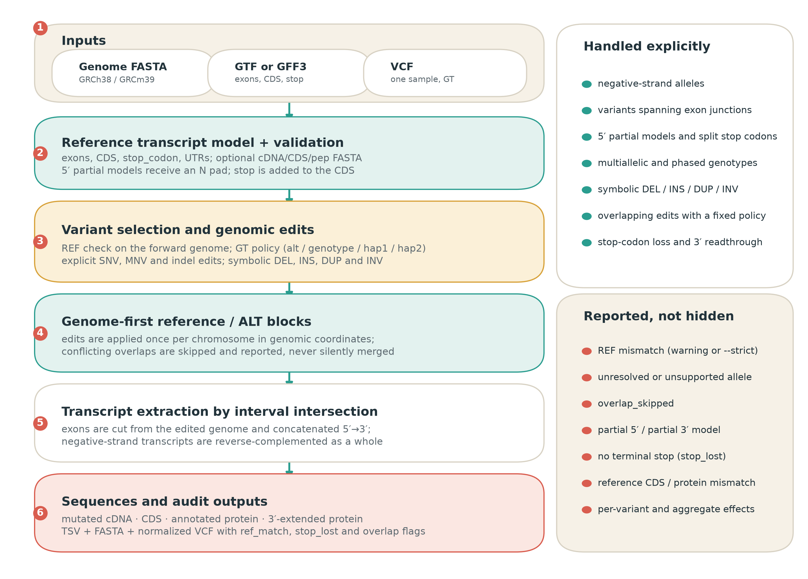
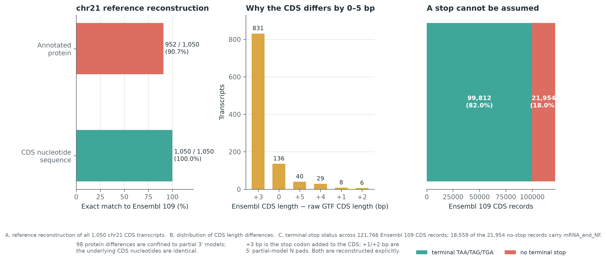
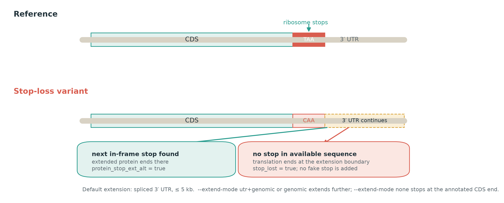

# mutatedSequence: a genome-first, allele-aware tool for reconstructing full-length mutated transcripts, CDS, and proteins from VCF data

**Preprint draft for bioRxiv — not yet submitted**

**Authors:** [Author 1]1, [Author 2]1, [Author 3]2

**Affiliations:**  
1 [Department, Institution, City, Postcode, Country]  
2 [Department, Institution, City, Postcode, Country]

**Corresponding author:** [Name, email address]

**Keywords:** variant effect prediction; transcript reconstruction; personalized proteome; VCF; structural variation; stop-loss; bioinformatics

---

## Abstract

**Motivation.** Whole-genome and whole-exome sequencing now produce large catalogues of somatic and germline variants. Many downstream analyses—protein structure prediction, neoantigen discovery, proteogenomics, and functional interpretation—require the actual sample-specific transcript, coding DNA, and protein sequences rather than a list of genomic coordinates. Existing annotators report consequences but often not complete mutated sequences; consensus tools are unaware of exon structure, strand, or allele choice.

**Results.** We present mutatedSequence, a dependency-free Python tool that reconstructs reference and mutated cDNA, CDS, and protein sequences for every selected transcript from a genome FASTA, a GTF/GFF3 annotation, and a single-sample VCF. Its genome-first block model applies variants once in genomic coordinates, then extracts exons and CDS segments by interval intersection. This makes exon-junction variants, negative-strand genes, 5′-partial models, split stop codons, multiallelic genotypes, and common symbolic deletions, insertions, duplications, and inversions explicit rather than accidental. The tool reports reference mismatches, unresolved alleles, overlapping edits, and stop-loss readthrough instead of silently emitting a plausible wrong sequence. On Ensembl release 109 chromosome 21, all 1,050 CDS nucleotide sequences were reconstructed exactly; 952 of 1,050 annotated proteins matched exactly, with the remaining 98 differences confined to partial 3′ models. Ten end-to-end scenario tests cover the variant classes above. Outputs include per-variant and per-transcript TSVs, FASTA files, a normalized VCF, and diagnostics.

**Availability.** mutatedSequence is publicly available at https://github.com/wenyuhaokikika/mutatedSequence and is distributed as an environment-only Docker image (`wenyuhaobuemoji/mutatedsequence`). The code uses only the Python standard library at runtime.

---

## Introduction

Whole-genome sequencing (WGS) and whole-exome sequencing (WES) have made it routine to call millions of germline variants and thousands of somatic variants from a single sample. The resulting Variant Call Format (VCF) records describe changes in genomic coordinates: a reference allele, one or more alternate alleles, and a genotype [12]. This representation is well suited to storage and consortium-scale sharing, and individual variants are conventionally described with HGVS nomenclature [11], but it is not the representation required by many biological analyses. Protein structure prediction, including AlphaFold3, RoseTTAFold, and protein language models such as ESM, consumes an amino-acid sequence [8–10]. Neoantigen prediction consumes mutated peptides. Proteogenomic search engines consume sample-specific protein FASTA files. In each case, the VCF must first be converted into a transcript- and protein-level sequence.

The obvious approach is to apply the VCF to the reference genome and then translate the affected transcript. This is more subtle than it first appears. A gene may be on the negative strand, so the alternate allele must be applied on the forward genome and the resulting transcript must be reverse-complemented as a whole. An exon may be split across a variant, so the variant's REF allele can include an intron that is absent from a per-exon FASTA. The annotated CDS often excludes the stop codon, and some transcripts have incomplete 5′ or 3′ ends. A multiallelic record may contain two different alternate alleles, and a genotype may be phased or unphased. Overlapping variants may be on the same or different haplotypes. Common structural variants are represented symbolically rather than as explicit REF/ALT strings. Each of these cases can turn a superficially reasonable translation into a wrong one.

A number of tools address parts of this problem. Ensembl VEP and SnpEff annotate variants with genes, transcripts, and predicted consequences [2,3]; they are not primarily designed to emit complete mutated cDNA, CDS, and protein sequences. BCFtools `csq` performs haplotype-aware consequence prediction but likewise reports consequences rather than full-length sequences [4]. Haplosaurus computes protein haplotypes from phased variation [5], and VCF2Prot generates personalized proteomes from consequence-called VCF files [6]; both are valuable, but they assume a particular input representation and do not focus on the full set of transcript-level edge cases considered here. ORFan provides a fast Rust implementation for mutated transcripts and peptides from coding variants [7]. These tools are complementary rather than interchangeable, and a head-to-head benchmark is outside the scope of this work.

We developed mutatedSequence to make the conversion reproducible and auditable, with explicit handling of the cases that most often cause silent errors. The tool takes a reference genome, an Ensembl-style GTF/GFF3 annotation, and a VCF for one sample. It returns, for each selected transcript, the reference and mutated cDNA, CDS, annotated protein, and a 3′-extended protein for stop-loss/readthrough analysis. It also returns a normalized VCF, per-variant and per-transcript tables, and diagnostics that explain reference mismatches and non-stop transcripts.

The contributions are:

1. A **genome-first block model** that applies each variant once in genomic coordinates and extracts transcript sequence by interval intersection, making exon-junction and negative-strand variants ordinary cases rather than special cases.
2. **Explicit allele and overlap semantics**: alternate-allele selection, genotype-aware modes, haplotype-specific modes, and a documented policy for conflicting edits.
3. **Reference reconstruction and auditing** for 5′-partial models, CDS stop codons, split stop codons, and optional Ensembl cDNA/CDS/protein FASTA checks.
4. **A separate 3′-extended protein** that models stop-codon loss and readthrough without pretending that the annotated stop is still present.
5. **Auditable outputs** (TSV, FASTA, normalized VCF, diagnostics) and a runtime with no third-party Python dependencies.

---

## Results

### Overview of the workflow

mutatedSequence is organized as a linear, inspectable pipeline (Figure 1). The three required inputs are a genome FASTA, a GTF/GFF3 annotation, and a single-sample VCF. The annotation is parsed into transcript models containing exons, CDS segments, stop-codon features, and UTRs. The reference cDNA, CDS, and protein are reconstructed first, and can be checked against optional Ensembl cDNA, CDS, or peptide FASTA files. Variants are then filtered, assigned to a sample, and converted into genomic edits according to the selected allele mode. The edits are applied to reference/alternate blocks in genomic coordinates. Finally, each transcript is extracted from the edited genome, reverse-complemented when necessary, translated, and written to the output tables and FASTA files.

The block representation is the key implementation choice. The genome is divided into reference blocks at every edit boundary. Each reference block is either retained or replaced by the corresponding alternate block; insertions become explicit blocks between reference blocks. Because the edit is represented in genomic coordinates, a deletion that begins in one exon and ends in the next is applied before exon extraction. The exon junction is therefore reconstructed from the edited genome, not from a pre-computed per-exon sequence. Negative-strand transcripts use the same forward-strand edit and are reverse-complemented only at extraction time.

### Reference reconstruction on Ensembl release 109

We evaluated reference reconstruction on all 1,050 CDS transcripts on chromosome 21 from Ensembl release 109 [1] (GRCh38). The reconstructed CDS nucleotide sequence matched the Ensembl `cds.all.fa` record exactly for **1,050 of 1,050 transcripts** (100%). The translated annotated protein matched the Ensembl `pep.all.fa` record exactly for **952 of 1,050 transcripts** (90.7%). The 98 differences were all in 3′-incomplete models: 91 were classified as `partial_3` and 7 as `partial_5_3`. In these models, the Ensembl peptide ends with a partial-codon convention that differs from the reconstructed translation; the underlying CDS nucleotides are identical. This is a property of the annotation, not a reconstruction failure.

The distribution of CDS length differences explains the apparent 0–5 bp discrepancies that users often observe when comparing a raw GTF CDS with Ensembl FASTA (Figure 2B). The most common difference is +3 bp (831 transcripts), corresponding to the stop codon that is present in the Ensembl CDS FASTA but absent from the GTF CDS feature. Differences of +1 and +2 bp (8 and 6 transcripts) correspond to 5′ partial models that require one or two N bases to preserve the reading frame. Differences of +4 and +5 bp (29 and 40 transcripts) combine a 5′ N pad with the 3′ stop codon. The tool reconstructs these cases explicitly and reports the 5′ N count and stop status rather than hiding them in a length difference.

### Variant scenario tests

The repository contains ten end-to-end tests built on a synthetic genome, annotation, VCF, and reference FASTA set. The tests assert both sequence-level and table-level behavior for:

- reference cDNA, CDS, and protein reconstruction;
- single-nucleotide and multi-nucleotide substitutions;
- frameshifts and in-frame insertions/deletions;
- negative-strand alleles;
- 5′-partial models and split stop codons;
- multiallelic and phased genotypes;
- symbolic `<DEL>`, `<INS>`, `<DUP>`, and `<INV>` alleles;
- REF mismatch, overlapping variants, and genotype edge cases;
- diagnostic output for raw CDS offsets;
- existence and schema of all output files.

All ten tests pass in the repository and in the Docker environment. The included demo VCF contains 40 records: 38 are selected, 35 are applied, two have a REF mismatch, two are unresolved, one overlapping edit is skipped, and seven are symbolic. The six demo transcripts all match the supplied reference cDNA, CDS, and protein before mutation, and the run summary reports two stop-lost transcripts and four stop-gained transcripts. These tests are designed to exercise the implementation, not to estimate accuracy on a clinical or population cohort; an independent variant-level truth set remains future work.

### A stop codon cannot be assumed

The annotation audit across 121,766 Ensembl release 109 CDS records shows why a naive “translate until the first stop” strategy is insufficient. Of these records, 99,812 (82.0%) end with a terminal TAA, TAG, or TGA, while 21,954 (18.0%) do not (Figure 2C). Among the no-terminal-stop records, 18,559 carry the `mRNA_end_NF` tag, indicating a 3′-incomplete model whose stop lies outside the known transcript. Separately, 758 of the 99,812 records end with a stop triplet but have a CDS length not divisible by three, so the triplet is not in frame. The strict no-in-frame-stop set is therefore 22,712 records (21,954 + 758).

This matters for two reasons. First, a reference protein that lacks a terminal stop is not necessarily a failed reconstruction; it may be a partial model, an immune segment, or a non-stop-decay transcript. Second, a mutation that removes the annotated stop can cause translation to continue into the 3′ UTR. The tool separates the two situations. The canonical annotated protein is translated from the reconstructed CDS. A second, 3′-extended protein is translated from the CDS plus a spliced 3′ UTR extension, up to a default of 5 kb. If an in-frame stop is found, the extended protein ends there and `protein_stop_ext_alt` is true. If no stop is found, translation ends at the boundary of the available sequence and the transcript is flagged with `stop_lost=true`; no artificial stop is appended (Figure 3). The default does not translate an entire chromosome. `--extend-mode utr+genomic` or `genomic` can extend beyond the annotated transcript, and `--extend-mode none` stops at the CDS end.

### Auditable outputs

For each variant–transcript pair, `mutation_report.tsv` records the original REF and ALT, the selected allele, the genotype, the consequence, and the reference/mutated cDNA, CDS, and protein sequences. `transcripts.tsv` adds transcript-level aggregates: reference class, stop-reason, sequence lengths, stop status, stop-loss/stop-gain flags, frameshift status, and whether the reconstructed reference matches the optional Ensembl FASTA. `variants.tsv` records why each VCF record was applied, skipped, unresolved, or flagged as a REF mismatch. `normalized.vcf` contains explicit REF/ALT alleles for SNVs, indels, and the supported symbolic classes; `run_summary.json` and `diagnostics.txt` summarize the run.

This structure is intended for review, not only for downstream consumption. A user can inspect a specific variant, see which allele was selected, compare the reference and alternate sequences, and determine whether a missing stop is annotated, mutation-induced, or simply outside the extension window.

### Scope and portability

The runtime uses only the Python standard library. It does not require BCFtools, samtools, pysam, or a compiled C extension. The repository provides a command-line interface, a test dataset, and an environment-only Docker image in which the code is bind-mounted at `/workspace`; the image contains no copy of the tool source. This design keeps the execution environment reproducible while allowing the code to be inspected and versioned independently.

---

## Discussion

mutatedSequence addresses a narrow but recurring problem: converting a VCF into full-length transcript and protein sequences in a way that is transparent about the choices made. The genome-first block model is not a new algorithm in the sense of a novel data structure; its value is that it makes the correct unit of application explicit. Once variants are applied to the genome, exon junctions, negative-strand genes, and overlapping transcript models are handled by the same extraction code. The alternative—applying variants separately to each exon or transcript—requires reimplementing edge-case logic for every transcript and is difficult to audit.

The tool is deliberately conservative. It does not infer a new splice isoform from a splice-site variant, it does not phase unphased genotypes, and it does not pretend that a symbolic translocation can be represented as one linear transcript. When an input cannot be represented, the tool reports `unresolved`, `overlap_skipped`, or a reference mismatch rather than emitting a plausible sequence. This is a design choice: for downstream structure prediction or neoantigen analysis, a silently wrong sequence can be worse than a missing one. The `--strict` option makes REF mismatches fatal for pipelines that prefer to stop rather than skip.

The validation reported here has clear limits. The chromosome 21 analysis establishes that reference reconstruction agrees with Ensembl at the nucleotide level for all 1,050 CDS transcripts, and explains the 98 protein-level differences in partial models. The ten scenario tests establish that the implementation handles the intended edge cases. Neither is a population-scale accuracy estimate, and we did not perform a head-to-head comparison with VEP, Haplosaurus, VCF2Prot, or ORFan. Such a comparison would need a shared truth set with phased haplotypes, simulated structural variants, and independent sequence verification. We also did not evaluate the effect of alternative splice isoforms, because the current model uses a fixed annotation.

Several limitations follow directly from the model. Unphased compound variants produce a mosaic consensus, not two haplotypes; users who need allele-specific protein sequences should phase the VCF and run the `hap1` and `hap2` modes separately. Splice-site variants are annotated but do not change the exon structure, so exon skipping, cryptic splicing, and intron retention require an alternative transcript model or a splice-aware tool. `<TRA>`, `<BND>`, and `<CNV>` are outside the single-linear-transcript model. Mitochondrial genetic codes, selenocysteine recoding, and programmed ribosomal frameshifting are not modeled. Nonsense-mediated decay is flagged through the reference class but not simulated. Finally, the output is a sequence-level hypothesis: it should be validated against RNA-seq, proteomics, or targeted assays when the biological conclusion depends on the exact protein.

These limitations suggest several extensions: haplotype-aware processing with phase blocks, integration of splice prediction, a pangenome or graph reference for complex structural variation, and direct export of mutated sequences to protein structure and neoantigen pipelines. The current implementation is intentionally small enough to be embedded in those workflows, and its outputs are designed to make the assumptions visible. mutatedSequence is a research tool; it is not a clinical variant interpreter and does not provide a diagnosis.

---

## Methods

### Inputs and preprocessing

The required inputs are a genome FASTA, a GTF/GFF3 annotation, and a VCF. The VCF is parsed for CHROM, POS, REF, ALT, FILTER, QUAL, and the selected sample's GT. Records can be filtered by quality, FILTER value, genotype missingness, and hom-reference status. Chromosome names are matched after configurable alias normalization (for example, `1` and `chr1`). The genome can be uncompressed with an `.fai` index or gzip-compressed; the uncompressed path is recommended for large genomes because gzip access requires loading the compressed file into memory.

The annotation parser recognizes transcript, exon, CDS, stop_codon, and UTR features. Transcripts are grouped by transcript ID, and exons and CDS segments are ordered according to the transcript strand. When explicit UTR features are absent, 3′ UTR segments are derived from the terminal exon and CDS coordinates. Transcript tags such as `mRNA_start_NF`, `mRNA_end_NF`, `cds_start_NF`, and `cds_end_NF` are retained for reference classification.

### Reference reconstruction

For each transcript, the reference cDNA is the concatenation of exon sequences in transcript orientation. The reference CDS is the concatenation of CDS segments, plus the stop codon when it is annotated separately, plus a 5′ N pad when the model is 5′-partial. The N pad is determined from the CDS phase and the partial-model tags; it preserves the reading frame without inventing a biological base. If an optional Ensembl cDNA, CDS, or peptide FASTA is supplied, the reconstructed sequence is compared with the corresponding record and the result is written to the output tables.

The reference protein is translated from the reconstructed CDS using the standard genetic code. Translation stops at the first in-frame stop codon by default. A separate extended CDS appends the spliced 3′ UTR and, optionally, a genomic extension; the extended protein is translated from this longer sequence. The reference class is assigned from the partial-model tags and the observed stop status: `complete`, `partial_5_complete_3`, `partial_5`, `partial_3_with_stop`, `partial_3`, `partial_5_3`, `non_stop_decay`, `immune_segment`, `nmd_partial`, or `no_stop_other`.

### Variant selection

Each VCF record is converted to a `ChosenAllele` according to the allele mode. In `alt` mode, the requested alternate allele is used; for a biallelic record the single alternate is used regardless of the requested index. In `genotype` mode, the first non-reference allele in the GT is used. In `hom` mode, the record is used only when both GT alleles are the same non-reference allele. In `hap1` and `hap2` modes, the corresponding GT allele is used; a homozygous genotype therefore contributes the same allele to both haplotypes, while a heterozygous genotype contributes one alternate allele to one haplotype and the reference to the other. Missing genotypes, hom-reference records, and out-of-range alternate indices are reported and skipped according to the selected flags.

The REF allele is checked against the forward-strand genome at `POS-1 : POS-1+len(REF)`. For multi-base REF alleles, the tool also searches a small window for the REF and reports the offset and strand. A mismatch is a warning by default and a fatal error under `--strict`; in either case the variant is not applied to the sequence. This check catches the most common causes of wrong output: an assembly mismatch, a transcript-based VCF, a different contig naming convention, or an indel anchor-base error.

### Genomic edits and the block model

An explicit SNV, MNV, or indel becomes a `reference` interval and an `alternate` string. For a symbolic `<DEL>`, the interval is taken from END or SVLEN; for `<INS>`, the inserted sequence is taken from the symbolic record or its sequence-resolved representation; `<DUP>` and `<INV>` are converted to explicit edits when the interval is known. `<TRA>`, `<BND>`, and `<CNV>` remain unresolved because they cannot be represented as a single linear transcript.

Edits are sorted by genomic position. If two accepted edits overlap, the later edit is skipped by default and recorded as `overlap_skipped`; the `--overlap error` policy aborts instead. The genome is then divided into reference blocks at all edit boundaries. Each block is retained, replaced, or supplemented by an insertion block. The resulting alternate sequence is a chain of reference and alternate blocks, and can be queried by any interval in genomic coordinates.

### Transcript extraction and translation

For each transcript, exons are intersected with the alternate block chain and concatenated in transcript orientation. The same operation is applied to CDS segments and the separately annotated stop codon. If the transcript is on the negative strand, the extracted sequence is reverse-complemented as a whole; the VCF allele itself is never reverse-complemented. This is the step that makes negative-strand variants and exon-junction variants use the same code path.

The mutated CDS is translated with the standard code. The annotated protein stops at the first in-frame stop, or at the end of the CDS if no stop is present. The extended CDS adds the spliced 3′ UTR (default up to 5,000 bp) and optionally a genomic extension; the extended protein is translated separately. A transcript is marked `stop_lost` when the reference annotated protein has a stop and the alternate extended protein does not. A transcript is marked `stop_gained` when the alternate CDS has a stop that the reference does not.

### Effect annotation and outputs

For each variant–transcript pair, the tool identifies the first differing codon and classifies the consequence as synonymous, missense, nonsense, start-lost, stop-lost, frameshift, in-frame insertion/deletion, splice-site, intronic, UTR, or non-coding. Per-variant effects are computed with only that variant applied; transcript-level aggregates use all accepted variants for the transcript. The output directory contains:

- `mutation_report.tsv` — per-variant, per-transcript sequences and effects;
- `transcripts.tsv` — one row per transcript with aggregate effects and reference checks;
- `variants.tsv` — one row per VCF record with application status and skip reason;
- `normalized.vcf` — explicit REF/ALT alleles for supported variants;
- `sequences/` — FASTA files for cDNA, CDS, annotated protein, and extended protein;
- `run_summary.json` and `diagnostics.txt` — run-level counts and explanations.

The TSV schema includes `ref_match`, `genome_ref`, `ref_offset`, `genome_context`, `reference_class`, `reference_stop_reason`, `protein_stop_alt`, `protein_stop_ext_alt`, `stop_lost`, `stop_gained`, `start_lost`, `frameshift`, and `overlap_skipped`.

### Validation datasets and software

Reference reconstruction was evaluated against Ensembl release 109 GRCh38 chromosome 21: 1,050 CDS transcripts from the GTF, `Homo_sapiens.GRCh38.cds.all.fa.gz`, and `Homo_sapiens.GRCh38.pep.all.fa.gz`. The genome-wide annotation audit used all 121,766 CDS records in the release 109 `cds.all.fa.gz`. The scenario tests use a synthetic genome and annotation designed to exercise each variant class; the demo VCF and expected reference sequences are included in the repository. All analyses used public reference data; no human participants or animal experiments were involved.

mutatedSequence version 2.0.0 requires Python 3.8 or later and has no third-party runtime dependencies. The command-line entry point is `mutatedseq`; the repository also provides a thin `./mutatedSequence` launcher. The Docker image contains the runtime environment only; the source is mounted at `/workspace` at run time.

---

## Data and code availability

The source code, test data, documentation (English and Chinese), and Docker instructions are available at https://github.com/wenyuhaokikika/mutatedSequence. The environment-only Docker image is available as `wenyuhaobuemoji/mutatedsequence:2.0.0` and `:latest` on Docker Hub. The manuscript figures are generated by `paper/make_figures.py`; the underlying counts are in the repository README and in `examples/demo_out/run_summary.json`.

## Competing interests

The authors declare no competing interests.

## Author contributions

[To be completed: conceptualization, software, validation, writing—original draft, writing—review and editing.]

## Acknowledgements

[To be completed.]

## References

1. Cunningham F, Allen JE, Allen J, et al. Ensembl 2023. *Nucleic Acids Research*. 2023;51(D1):D933–D941. doi:10.1093/nar/gkac958.
2. McLaren W, Gil L, Hunt SE, et al. The Ensembl Variant Effect Predictor. *Genome Biology*. 2016;17:122. doi:10.1186/s13059-016-0974-4.
3. Cingolani P, Platts A, Wang le L, et al. A program for annotating and predicting the effects of single nucleotide polymorphisms, SnpEff. *Fly (Austin)*. 2012;6(2):80–92. doi:10.4161/fly.19695.
4. Danecek P, Bonfield JK, Liddle J, et al. Twelve years of SAMtools and BCFtools. *GigaScience*. 2021;10(2):giab008. doi:10.1093/gigascience/giab008.
5. Spooner W, McLaren W, Slidel T, et al. Haplosaurus computes protein haplotypes for use in precision drug design. *Nature Communications*. 2018;9:4128. doi:10.1038/s41467-018-06542-1.
6. ElAbd H, Degenhardt F, Lenz TL, Franke A, Wendorff M. VCF2Prot: an efficient and parallel tool for generating personalized proteomes from VCF files. *bioRxiv*. 2022. doi:10.1101/2022.01.21.477084.
7. ngs-ai-org. ORFan: open reading frame analysis toolkit. GitHub. https://github.com/ngs-ai-org/orfan. Accessed 24 October 2026.
8. Abramson J, Adler J, Dunger J, et al. Accurate structure prediction of biomolecular interactions with AlphaFold 3. *Nature*. 2024;630:493–500. doi:10.1038/s41586-024-07487-w.
9. Baek M, DiMaio F, Anishchenko I, et al. Accurate prediction of protein structures and interactions using a three-track neural network. *Science*. 2021;373:871–876. doi:10.1126/science.abj8754.
10. Lin Z, Akin H, Rao R, et al. Evolutionary-scale prediction of atomic-level protein structure with a language model. *Science*. 2023;379:1123–1130. doi:10.1126/science.ade2574.
11. den Dunnen JT, Dalgleish R, Maglott DR, et al. HGVS recommendations for the description of sequence variants: 2016 update. *Human Mutation*. 2016;37(6):564–569. doi:10.1002/humu.22981.
12. Danecek P, Auton A, Abecasis G, et al. The variant call format and VCFtools. *Bioinformatics*. 2011;27(15):2156–2158. doi:10.1093/bioinformatics/btr330.

---

## Figure legends

**Figure 1. Genome-first workflow of mutatedSequence.** The three required inputs are a genome FASTA, a GTF/GFF3 annotation, and a single-sample VCF. Reference transcript models are reconstructed and optionally checked against Ensembl FASTA files. Variants are selected and converted into explicit genomic edits; edits are applied to reference/alternate blocks in genomic coordinates; exons and CDS segments are then extracted by interval intersection. Negative-strand transcripts are reverse-complemented as a whole at extraction. The final outputs are mutated cDNA, CDS, annotated protein, 3′-extended protein, and audit tables. The right panels list cases handled explicitly and conditions that are reported rather than hidden.

**Figure 2. Reference reconstruction and annotation audit.** (A) Exact matches between reconstructed sequences and Ensembl release 109 chromosome 21 records for 1,050 CDS transcripts: CDS nucleotide sequence, 1,050/1,050 (100%); annotated protein, 952/1,050 (90.7%). The 98 protein differences are confined to partial 3′ models; the underlying CDS nucleotides are identical. (B) Distribution of the difference between the Ensembl CDS length and the raw GTF CDS length. The +3 bp mode is the stop codon added to the CDS; +1 and +2 bp modes are 5′ partial-model N pads; +4 and +5 bp combine both. (C) Terminal-stop status across 121,766 Ensembl release 109 CDS records. Of the 21,954 records without a terminal stop, 18,559 carry `mRNA_end_NF`, indicating a 3′-incomplete model.

**Figure 3. Stop-codon loss and 3′ readthrough.** In the reference transcript, the ribosome terminates at the annotated stop codon. When a variant changes the stop codon (for example, TAA to CAA), translation continues in the same reading frame into the spliced 3′ UTR. If a downstream in-frame stop is found, the extended protein ends there and `protein_stop_ext_alt` is true. If no stop is found within the available extension, the transcript is marked `stop_lost=true` and no artificial stop is appended. The default extension is the spliced 3′ UTR up to 5 kb; `--extend-mode utr+genomic` or `genomic` extends further, and `none` stops at the annotated CDS end.

---

## Tables

**Table 1. Relationship to existing tools.** The comparison describes typical primary outputs and input assumptions; it is not a performance ranking.

| Tool | Primary output | Typical input | Relationship to this work |
|---|---|---|---|
| Ensembl VEP / SnpEff | Variant consequences, genes, transcripts, HGVS | VCF + annotation | Excellent annotation breadth; not primarily a full-length sequence emitter |
| BCFtools `csq` | Haplotype-aware consequences | VCF + GFF + reference | Fast and established; reports consequences rather than complete cDNA/CDS/protein |
| Haplosaurus | Protein haplotypes | Phased variants + transcript models | Strong for phased protein haplotypes; requires phasing and focuses on CDS/protein |
| VCF2Prot | Personalized proteome FASTA | Consequence-called VCF + reference proteome | Efficient proteome generation; not a transcript-level cDNA/CDS audit tool |
| ORFan | Mutated transcripts and peptides | VCF + GTF + genome | Fast Rust implementation for coding variants; no peer-reviewed paper identified at the time of writing |
| mutatedSequence | Full cDNA, CDS, annotated and extended protein + audit TSV | VCF + GTF/GFF3 + genome | Explicit transcript-level edge cases, allele/overlap policy, and reference diagnostics |

**Table 2. Scenario coverage in the end-to-end test set.** Each row is implemented as an assertion in `tests/test_pipeline.py`; the table summarizes the intended behavior, not an external accuracy estimate.

| Scenario | Asserted behavior |
|---|---|
| Reference reconstruction | cDNA, CDS, and protein match the supplied reference records |
| SNV / MNV | Correct codon change and consequence |
| Frameshift / in-frame indel | Correct CDS length, protein effect, and frameshift flag |
| Negative strand | ALT applied on the forward genome; transcript reverse-complemented |
| 5′ partial and split stop | N pad preserves frame; split stop codon is reconstructed |
| Multiallelic / phased | Selected allele is explicit; hap1/hap2 differ correctly |
| Symbolic DEL/INS/DUP/INV | Resolved to explicit edits where possible; unresolved cases reported |
| REF mismatch / overlap / GT edge cases | Warning or `--strict` abort; overlap policy and skip reasons recorded |
| Diagnostics | Raw CDS offset and leading-N explanations are emitted |
| Output schema | All expected tables and FASTA files exist and are parseable |
